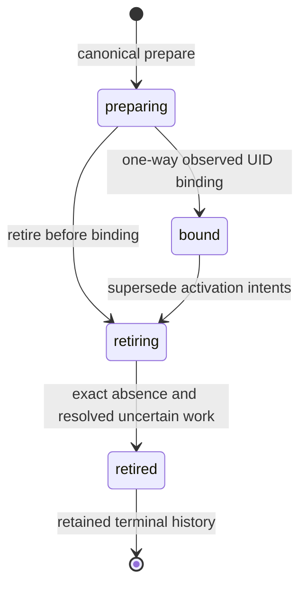

# GN-G2 Canonical Lifecycle and Claim Foundation

Assignment: `UTCP_GN_G2_CANONICAL_LIFECYCLE_AND_CLAIM_FOUNDATION`.
Date: 2026-10-21. Worker: OpenAI Codex CLI; requested GPT-6 / High;
role: Principal Laravel/PostgreSQL Control Plane Engineer / Distributed Systems
Engineer. This is an isolated implementation and developer-verification packet.
The adapter ADR remains **PROPOSED / NOT ADOPTED**.

## Verdict and evidence boundary

**GN_G2_CANONICAL_LIFECYCLE_POSTGRESQL_VERIFIED** — the additive canonical
foundation passes developer verification against real disposable PostgreSQL,
including independent concurrent transactions, process-restart recovery and
PHP/Go v1/v2/v3 mTLS claim/fingerprint integration. It is ready for independent
review. This verdict is not independent acceptance, production migration,
deployed integration or natural-live telephony proof.

The new foundation persists infrastructure incarnation and intent evidence while
reusing the existing runtime-operation engine, tenant/RuntimeNode authority and
C0 audit/outbox. It introduces no dispatcher, production callback route, service
provider binding, Kubernetes client or Go database access. Existing PHP Deployment
writers continue unchanged. Fresh claim verification is read-only authorization;
a durable pre-dispatch reservation and authenticated observation-receipt protocol
remain production-integration prerequisites.

## Repository identity and preservation

Starting branch: `main`. Starting HEAD:
`4ef700639c50a58933bc5a0d1e7ae08628cc4c62`.
The initial working tree contained 205 untracked E1–GN-G2 artifacts and no tracked
or staged changes. All 205 were inventoried with SHA-256, reviewed for syntax,
contracts, links and secrets, then preserved in the explicitly authorized local
commit `5e028b9ab3d96f3430bf715f89d66ab19a758761`:
`chore: preserve reviewed E1 through GN-G2 infrastructure foundation`.
No unrestricted staging, reset, clean or push was used. The prior artifacts
remain byte-for-byte unchanged; committing the proposed ADR did not adopt it.

The complete preservation inventory is reproducible with:

```bash
git show --format= --name-only 5e028b9ab3d96f3430bf715f89d66ab19a758761
```

Final branch/HEAD remain `main` /
`5e028b9ab3d96f3430bf715f89d66ab19a758761`, with 17 new untracked task files,
no tracked or staged modifications and all 205 preserved hashes unchanged.
New implementation and documentation remain outside that preservation commit.
A historical extra blank line at EOF in the preserved Lifecycle V2 report was
reported rather than edited. No implementation commit is authorized here.

## Existing canonical source and implementation seam

| Existing authority | Confirmed behavior | Foundation use |
| --- | --- | --- |
| [RuntimeOperationRepository](../../../apps/api/app/ControlPlane/RuntimeOperations/RuntimeOperationRepository.php) | Canonical operation ID, tenant/node association, status, attempts, lease tokens, expiry and retry; PostgreSQL `FOR UPDATE SKIP LOCKED` claiming | Reuse operation rows; no parallel lease or operation engine |
| [RuntimeRegistryService](../../../apps/api/app/RuntimeRegistry/RuntimeRegistryService.php) | Canonical RuntimeNode lifecycle/configuration and domain transitions | Lock tenant-owned RuntimeNode before incarnation and intent work |
| [AuditRepository](../../../apps/api/app/ControlPlane/Audit/AuditRepository.php) | Existing C0 append-only audit contract | Append minimal tenant-correlated transition metadata inside the caller transaction |
| [OutboxRepository](../../../apps/api/app/ControlPlane/Messaging/OutboxRepository.php) | Existing transactional event persistence | Append lifecycle/effect events in the same transaction |
| [TelephonyDomainService](../../../apps/api/app/TelephonyDomain/TelephonyDomainService.php) | Existing Asterisk conference/fence admission and replacement eligibility | Check established domain provenance; do not invent FreeSWITCH domain support |
| [Five-corridor source mapping](gn-g2/active-source-parity.md) | PHP provisioning, convergence, fencing, restoration, deprovisioning | Restrict operation-type/action combinations; preserve production callers |

The existing engine may reclaim an expired operation with a fresh token/attempt.
That does not establish whether an old Kubernetes request applied. Persisted
attempted/unknown evidence therefore blocks new mutation authorization until
observation resolves the uncertainty. `assertFence()` alone is insufficient for
the full infrastructure identity, action and lifecycle envelope.

## Added persistence

The additive [migration](../../../apps/api/database/migrations/2026_10_21_100000_create_infrastructure_incarnation_authority.php)
creates two subordinate tables, with restrictive references to existing authority.

| Table | Durable responsibility | Database protections |
| --- | --- | --- |
| `infrastructure_incarnations` | Tenant/RuntimeNode, trusted cluster/namespace, generated physical identity, immutable profile/configuration, bound UID, lifecycle and current generation | Unique cluster/namespace/name and preparation key; one-current-incarnation partial unique index; restrictive tenant/node FKs; PostgreSQL lifecycle/generation checks; immutable identity and one-way UID trigger; retained history |
| `infrastructure_intents` | Existing operation reference, exact closed envelope without claim credentials, action/generation/fingerprint, supersession, dispatch attempt and effect outcome | Unique incarnation/generation/action and operation/action; restrictive FKs; valid outcome/generation check; immutable envelope and irreversible supersession trigger; retained history |

Operation IDs, claims and leases remain in `runtime_operations`. The stored
infrastructure envelope excludes the wire `claim`; it does not copy fencing tokens
into a second credential store. Audit/outbox metadata contains incarnation and
optional operation IDs, not raw action envelopes, tokens or Secret contents.
Global PayloadSafety is unchanged; sensitive reference-shaped fields are not
inserted into ordinary operation payloads to bypass its policy.

PostgreSQL triggers require initial preparing state/generation `1`/unbound UID and
matching canonical node tenancy, and protect identity/history against direct
updates and deletes.
Lifecycle methods serialize against the existing RuntimeNode row, then incarnation
and intent rows. Business policy and full-envelope consistency remain service
invariants; SQL triggers are not a substitute for tenant or telephony admission.
SQLite test behavior does not establish these PostgreSQL protections.

## Canonical lifecycle and identity

[CanonicalInfrastructureService](../../../apps/api/app/ControlPlane/InfrastructureAuthority/CanonicalInfrastructureService.php)
provides `prepare`, `bind`, `nextGeneration`, `retire`, `completeRetirement`,
`persistIntent`, `verify`, `recordOutcome`, `resolveObserved` and tenant-scoped
`unresolved` recovery. It never sends a Kubernetes request.



Preparation validates tenant/RuntimeNode ownership, provider family, namespace and
closed configuration. It allocates a random 32-character incarnation and physical
name `utcp-<incarnation>`, starts generation `1`, and denies a second nonretired
incarnation for the same RuntimeNode under the serialized service boundary.
An identical preparation key returns the same record only when its inputs match.
A replacement after retirement receives a new identity and physical name.

Binding records the UID once. An identical already-bound UID is idempotent;
a different UID is rejected. A delayed create observed while retiring may bind
its UID for cleanup while remaining retiring. It does not regain activation
authority. Retired identities cannot rebind or reactivate.

Retirement advances the generation and supersedes old intents. Completion requires
retiring state, caller-provided exact absence evidence, and no attempted/unknown/
requires-observation effects. The present internal method trusts that evidence
input; authenticated receipt acquisition/validation is deferred, not proven by a
boolean argument. No delete acknowledgement is treated as absence evidence.

## Transactional generation authority

Generation values are decimal strings throughout service and wire boundaries.
Storage uses positive PostgreSQL signed `BIGINT`, matching the existing Go
contracts' supported range: `1` through `9223372036854775807`. Increment uses
string arithmetic, avoiding floating point and JavaScript-safe-integer limits.
`9007199254740993` remains exact; attempting to advance the maximum fails closed.
PostgreSQL rejects out-of-range storage independently. Contract parsing is not an
unbounded-number promise; no normative contract is broadened or truncated.

RuntimeNode/incarnation locks serialize allocation. A committed new generation
supersedes previous intents. Rollback must undo the generation change and its
audit/outbox events. Multiple actions may share a generation only under the same
fingerprint; action-specific immutable intent records bind their exact envelopes.

## Intent, configuration and fingerprints

New production-namespace [v1](../../../apps/api/app/ControlPlane/InfrastructureAuthority/ActionFingerprint.php),
[v2](../../../apps/api/app/ControlPlane/InfrastructureAuthority/LifecycleFingerprint.php)
and [v3](../../../apps/api/app/ControlPlane/InfrastructureAuthority/ActiveFingerprint.php)
validators implement closed permitted fields and independent deterministic
fingerprinting. They do not import test-only PHP generators or Go implementation.
The Go integration compares freshly persisted PHP fingerprints with the existing
independent Go algorithms for all three versions.

Canonical configuration contains digest-qualified image identity,
`configuration_id`, `configuration_sha256` and `secret_name`. Active requests must
match the immutable stored profile/configuration. No Secret payload is read or
persisted. This binds approved reference identity; it does **not** prove the
current contents of a mutable Kubernetes Secret or ConfigMap. Future production
publication must use immutable/versioned resources or another reviewed content
identity mechanism. Rotation requires new approved configuration/incarnation
semantics rather than silently changing the contents behind a trusted reference.
The existing closed Asterisk v3 profile specifically mounts the fixed optional
ConfigMap `asterisk-local-sip-fixtures`
([projection source](../../../components/kubernetes-effects/active/projection.go)).
Its contents are not bound by a reference fingerprint. A publisher cannot replace
that name with arbitrary versioned names through the current closed contract;
production immutable publication may require an explicitly versioned profile
extension as well as a publisher. No such extension is implemented here.

## Fresh full-envelope claim verification

Each `verify()` call reads PostgreSQL; there is no positive authorization cache.
Authorization requires the exact persisted envelope, canonical current generation
and target, eligible lifecycle, permitted operation/action corridor, unsuperseded
intent, eligible effect outcome and current runtime operation. Checks include:

- Tenant and RuntimeNode, trusted cluster/namespace/name, incarnation, target ID,
  slug and bound UID, action, version, profile and configuration fingerprint.
- Existing operation identity/status, attempt number, exact lease token and lease
  expiration, plus a future request deadline.
- No unresolved previous dispatch, incompatible profile, supersession, cancelled
  operation, retirement hold or older-version activation bypass.

Malformed, unavailable or inconsistent authority returns a redacted
`authorized: false` response. Caller-supplied tenant values are lookup constraints,
not evidence of ownership. No public Laravel callback route is added. The test
bridge invokes this same service and has no mutation or lifecycle authoring API.

| Contract | Additional canonical policy |
| --- | --- |
| v1 `admit_generation` / `set_replicas` | Bound incarnation required; nonzero replica effects additionally require a previously confirmed v3 provider projection and applicable domain eligibility |
| v2 `create_suspended` | Preparing only; exact generated identity; inert template contract retained |
| v2 `converge_projection` | Bound only; inert projection cannot request nonzero replicas to bypass v3 activation |
| v2 `retire_delete` | Retiring only; exact bound target and retirement operation |
| v3 `converge_projection` | Bound only; current immutable UID, approved matching runtime profile/configuration and current intent |

Asterisk fence/restoration checks reuse existing operation provenance, conference
binding, replacement eligibility, RuntimeNode configuration and source-fence
requirements. They do not replace fresh owned-Pod/readiness/listener/event-epoch
observations used by existing domain handlers. FreeSWITCH domain fencing and
restoration remain explicitly unsupported; provider projection support does not
establish those domain capabilities.

## Durable uncertain effects and restart recovery

Effect evidence uses `not_dispatched`, `dispatch_rejected`, `dispatch_attempted`,
`outcome_unknown`, `confirmed_applied`, `confirmed_not_applied`,
`requires_observation` and `terminally_resolved`. Supersession remains a separate
irreversible marker so uncertain historical effects remain discoverable.
Transitions are explicit and tied to the recorded dispatch attempt. A stale
executor result must not resolve a newer in-flight attempt.

`unresolved(tenant)` returns attempted/unknown/requires-observation records,
including superseded ones. Lease expiry, worker restart, operation reclaim or
retirement does not erase them and does not authorize blind replay. Trusted
observation may resolve the exact recorded attempt; otherwise new reconciliation
must remain separate from effect execution. No resourceVersion refresh, UID
rebinding or PHP fallback occurs here.

The distributed boundary remains non-atomic. PostgreSQL cannot revoke a dispatched
Kubernetes request. The service does not yet connect its durable attempted marker
to the Go callback through a reservation/consumption handshake. Recording attempted
before the existing read-only claim callback intentionally denies authorization;
recording it afterward leaves a crash window unless integration closes that gap.
The next assignment addresses that protocol rather than hiding it behind retries.

## Audit and outbox

Each relevant lifecycle, intent and effect transition appends existing C0 audit
and outbox records inside the same database transaction. Idempotent retries return
existing evidence without duplicating transition events. A rolled-back transaction
must emit neither a successful state transition nor a committed audit/outbox event.
The implementation uses existing repositories and event envelopes, not another
messaging system. Existing outbox delivery retry remains existing-worker behavior;
this isolated foundation does not publish infrastructure commands automatically.

## Verification environment and results

The reproducible entry point is:

```bash
tests/gn-g2-canonical/verify
```

It delegates to the repository-owned
[`scripts/control-plane/canonical-proof`](../../../scripts/control-plane/canonical-proof).
This assignment executed `tests/gn-g2-canonical/verify postgres-only` and
`tests/gn-g2-active-projection/verify offline` separately, followed by repository
checks. The default `verify` mode composes those same stages; it is a reproduction
entry point, not an additional claimed test run.
The proof uses a unique run-owned Docker network, unique PostgreSQL container/data
volume, explicit `utcp_canonical_proof` database and temporary private environment
files. PostgreSQL has no published host port; the PHP bridge is restricted to an
ephemeral loopback publication. It never reads the application `.env`. Only owned
resources are removed.

Pinned tools:

- PHP image: `sha256:9efe210fb8c8e7c90d80fce2b6916b46824f0f0428d6037dd599ec5ef1dd4d7d`.
- PostgreSQL 17.6 image: `postgres@sha256:ef257d85f76e48da1c64832459b59fcaba1a4dac97bf5d7450c77753542eee94`.
- Go 1.25.8 SDK: `golang@sha256:4557cf171e3cdf5053a298d5171b1a5f5734d920260c25f22c79e94760eb2084`.
- Existing Kubernetes client-go/api/apimachinery: `v0.35.3`.

[PostgreSQL proof tests](../../../tests/gn-g2-canonical/PostgresProofTest.php)
use fresh PHP processes and separate PostgreSQL connections. The coordinator holds
the RuntimeNode lock, releases local barriers, confirms real PostgreSQL lock
contention, then releases the transaction. Scenarios cover generation allocation,
preparation, conflicting UID binding, retirement versus verification/allocation,
supersession, rollback, numeric boundaries, direct database guards and retained
identity. Restart proof kills a worker after uncertain evidence commits and
recovers that record from a newly bootstrapped application process.

The [test-only PHP bridge](../../../tests/gn-g2-canonical/CanonicalIntegrationBridge.php)
uses the real disposable database-backed Laravel verifier. An ephemeral Go mTLS
frontend authenticates the client and forwards bounded requests to a run-owned
loopback PHP container. Independent existing Go v1/v2/v3 claim verifiers call it
repeatedly. Database credentials stay in PHP; action exports remain private under
`/tmp`, not repository evidence. This is HTTP/mTLS integration simulation backed
by real PostgreSQL, not a production callback deployment.
TLS terminates in the test Go frontend; the PHP hop is loopback HTTP. This is not
native PHP TLS or a production callback implementation. Invalid-certificate and
rotation regressions come from the separately executed existing offline mTLS
suites.

The final disposable verification run is `NsGlin`, with owned run identity
`utcp-gn-canonical-20261021215913-821a413ec0`. The final
`tests/gn-g2-canonical/verify postgres-only` command exits `0`: all its canonical
verification stages pass after the documented harness corrections. Initial
failed attempts and independent baseline failures remain recorded separately.
Cleanup confirms removal of the run-owned
containers, data volume and network; no pre-existing resource was removed.

| Executed command/category | Current result |
| --- | --- |
| Focused `CanonicalInfrastructureTest.php` on SQLite | PASS: 19 tests, 80 assertions; service regression proof only |
| Fresh PostgreSQL migration and immediate repeat | PASS: 63 migrations applied; repeat found no pending migrations |
| Focused `CanonicalInfrastructureTest.php` on PostgreSQL | PASS: 19 tests, 80 assertions; 8.036 s / 44.5 MB in the final fresh run |
| Independent `tests/gn-g2-canonical/PostgresProofTest.php` on PostgreSQL | PASS: 11 tests, 115 assertions; 28.267 s / 34 MB in final run `NsGlin`; separate backend PIDs, observed lock waits and SIGKILL/restart recovery |
| Corrected canonical PHP/Go live bridge | PASS: normal and race runs; five independent fingerprints, ten actual database-backed claim decisions and ten typed wire round trips; 54 verbose PASS entries total, zero skips/failures; vet/module verification also pass |
| Initial canonical PHP/Go live bridge | FAIL: the current v2 `create_suspended` claim was denied; the other nine claim cases and five fingerprints passed; this is not a completed integration gate |
| Compatible existing C0 PostgreSQL regression suites | PASS: 11 tests / 37 assertions; 18.976 s / 42.5 MB; operation repository, audit/outbox and idempotency |
| Initial broad PostgreSQL regression including `RuntimeEngineTest.php` | FAIL: 7 tests / 36 assertions / 1 fixture error; pre-existing PostgreSQL adapter CHECK mismatch below |
| Existing RuntimeEngine and IdentityAuthorization suites on unchanged SQLite fixtures | PASS: 43 tests / 447 assertions; 1.831 s / 54.5 MB; not PostgreSQL fixture proof |
| Initial PostgreSQL regression including `IdentityAuthorizationTest.php` | FAIL: 14 tests / 60 assertions / 1 fixture error; pre-existing scalar JSON-equality assertion below |
| `tests/gn-g2-active-projection/verify offline` | PASS: complete offline observer/effects/lifecycle/profile chain; 608 verbose Go PASS entries include subtests and repetitions |
| Corrected `components/kubernetes-effects/verify` rerun | PASS: normal/race/vet/module/format and observer/static regressions; 427 verbose Go PASS entries include subtests/repetitions; seven generic environment skips are not live proof |
| Existing offline PHP effects suite | PASS: 111 tests / 597 assertions, executed twice by each composed effects verifier |
| Existing offline PHP observer suite | PASS: 59 tests / 368 assertions |
| Existing offline PHP lifecycle suite | PASS: 20 tests / 209 assertions, executed twice |
| Existing offline PHP active-profile suite | PASS: 20 tests / 267 assertions, executed twice |
| `make repository-hygiene phase-status-consistency-check` | PASS; 17 changed files, status-impact `no` |
| `git diff --check` and new-document whitespace/local links | PASS |
| Final disposable-resource cleanup | PASS: owned containers, data volume and network removed |
| All 17 new files: UTF-8, whitespace and targeted secret checks | PASS; zero introduced secret findings |
| New Bash/Python verifier syntax and local documentation links | PASS |
| New PHP source/tests: syntax and repository Pint checks | PASS: 10 PHP files |
| `scripts/ci/secret-scan` | FAIL, exit 1; sole current finding is the pre-existing UI variable assignment described below |
| `make runtime-engine-config-check` | FAIL, exit 2; unchanged independent baseline defect below |

The composed offline verifier invokes `components/kubernetes-effects/verify`
and `components/kubernetes-observer/verify`, plus fixture-enabled lifecycle and
active-profile checks. Inside the pinned Go modules it executes:

```bash
go test -count=1 -v ./...
go test -race -count=1 ./...
go vet ./...
go mod verify
```

Formatting uses `gofmt -l` with an empty-output assertion. Existing static
verifiers validate normative v1/v2/v3 schemas, fixtures, local links and isolation.
The canonical bridge additionally runs its named PostgreSQL integration test both
normally and with `-race` while the disposable database is alive.

```bash
go test -count=1 -v -run TestCanonicalPostgreSQL ./...
go test -race -count=1 -v -run TestCanonicalPostgreSQL ./...
```

The initial composed offline Go run reports six environment-dependent skips.
The corrected effects rerun reports seven generic environment skips, including
two canonical PostgreSQL integration hooks. Existing lifecycle/profile parity
tests are rerun by their fixture-enabled verifiers. The new canonical PostgreSQL/
mTLS tests require their own live verifier; a skipped generic run is not proof.

| Proof category | Classification |
| --- | --- |
| New Laravel service and PostgreSQL migration | Implemented; focused PostgreSQL developer tests pass |
| Independent concurrent transactions and process restart | PostgreSQL-tested with separate processes, backend PIDs and SIGKILL/restart; 11 tests / 115 assertions |
| PHP/Go fingerprints and mTLS claims | Integration-tested through the Go mTLS frontend, loopback PHP service and disposable PostgreSQL; normal and race runs pass |
| Existing Go observer/effects/lifecycle/profile offline verifier | Developer-tested this assignment; commands and counts above |
| Kubernetes API semantics | Prior evidence retained; no new Kubernetes test or mutation in this Laravel-only assignment |
| Production migration, deployment, dispatch and telephony | Not executed; not claimed |

## Root-cause corrections during developer verification

Disposable PostgreSQL exposed two migration details that SQLite cannot prove:

- The existing kernel operation primary key is `char(32)`. The new subordinate
  intent FK uses that actual type; an initial UUID declaration was incompatible.
- Laravel `migrate:fresh` drops tables while PostgreSQL trigger functions can
  survive. Owned functions use `CREATE OR REPLACE FUNCTION` so a repeated fresh
  migration installs the same protections without a duplicate-function failure.

Review also tightened stale-attempt handling before idempotent outcome returns
and denied Asterisk fencing when the node has recovered to ready. Permanent
regressions exercise those cases. These are bounded corrections to new source,
not changes to existing deployed workers or normative Go contracts.

The new PostgreSQL proof harness initially evaluated `Kernel::class` before its
import, preventing worker bootstrap. The worker imports now precede bootstrap.
Coordinator polling clears the PostgreSQL statistics snapshot before checking
lock contention, and PHPUnit stops on failures as well as errors. That failed
harness run is not PostgreSQL concurrency proof; the corrected fresh run is
reported separately above.
The first live callback attempt also exposed that this Docker environment did
not publish the PHP bridge port from an internal network. The corrected harness
uses a separate run-owned bridge, no PostgreSQL host publication and an explicitly
verified PHP loopback port. The earlier callback attempt is not mTLS proof.

The first database-backed PHP/Go claim run then exposed a test-frontend parser
mismatch: the v1 strict parser rejects `null`, while normative v2 suspended-create
requests require null UID/resourceVersion before binding. The new frontend now
selects the existing version-specific v2/v3 decoders; the v1 parser and all prior
contracts remain unchanged. A permanent regression accepts the normative v2 null
create fixture while still rejecting duplicate and unknown fields. Exported
action envelopes also pass a typed round-trip check. The failed initial bridge
run is retained as failed verification. The corrected fresh PostgreSQL-backed
mTLS run then passed normal and race execution, all five fingerprints, all ten
claim decisions and all ten typed wire round trips.
The added fixture regression initially read the documentation-tree contract path,
which the existing module verifier does not mount. It now reads the identical
preserved fixture copy under `lifecycle/contracts/fixtures.json`, available inside
the existing module mount. This test-harness correction changes neither the prior
verifier nor production code; the corrected full effects verifier then passed anew, including the permanent
`TestCanonicalClaimBridgeVersionedValidation` regression. No existing verifier
was modified.

## Baseline defects and separate disposition

`make runtime-engine-config-check` retains the historical assertion:
`ordinary platform workers must not carry the Kubernetes API client label`,
affecting `utcp-platform/api`, `utcp-platform/scheduler` and
`utcp-platform/telephony-reconciler`. Accepted K5 manifests currently require those
labels. This assignment neither suppresses the failure nor changes the checker,
RBAC or manifests. A focused positive/negative regression repair remains separate.

An additional pre-existing PostgreSQL regression fixture mismatch was exposed:
`RuntimeEngineTest::test_command_worker_executes_success_retry_terminal_and_unsupported_paths`
uses `unknown-test-adapter` at `apps/api/tests/Feature/RuntimeEngine/RuntimeEngineTest.php:143`,
which violates the existing `runtime_nodes_adapter_key_check` with SQLSTATE `23514`.
The initial broad run stopped at 7 tests / 36 assertions / 1 error. No production
constraint is weakened and the unrelated fixture is not repaired here.

A second pre-existing fixture mismatch occurs in
`IdentityAuthorizationTest::test_admin_routes_enforce_platform_and_tenant_capabilities`:
`apps/api/tests/Feature/Identity/IdentityAuthorizationTest.php:116` uses
`assertDatabaseMissing` with a scalar equality predicate against the audit
`metadata` JSON column. PostgreSQL reports SQLSTATE `42883` because that JSON
equality operator is unavailable. This run stopped at 14 tests / 60 assertions /
1 error. Compatible C0 PostgreSQL suites and unchanged SQLite identity/runtime
regressions are reported separately; SQLite does not prove these fixtures on
PostgreSQL. Neither baseline fixture is weakened to make this assignment pass.

The whole-repository secret scanner flags the existing UI assignment
where the local secret variable receives `credentialForm.secret`, at
`apps/web/src/views/ExternalTrunkDetailView.vue:292`. Review found a variable
reference, not a credential literal. Three preserved Go tests also contain explicit
synthetic token sentinels. Their contents remain unchanged. Raw scanner failures
must be reported with this disposition, not advertised as a passing secret scan.
No database credentials, certificates, tokens or private action exports belong in
this report or the commit.

## Production integration, adoption and next work

The [migration/backfill plan and one complete next-assignment prompt](gn-g2/canonical-foundation-migration-and-handoff.md)
cover legacy identity adoption, immutable configuration publication, retained
history, compatible rollback and durable reservation/observation receipts.
No automatic backfill fabricates a UID or assigns a fresh incarnation to an
already-running legacy workload. New incarnations are preferred; legacy adoption
requires a separately controlled write freeze, exact observations and reviewed
identity extension.

GN-G3 remains unauthorized. Prerequisites include adopted authority contracts,
production lifecycle/claim integration, trusted observation receipts, durable
dispatch reservations, configuration publication, legacy request draining,
unknown-outcome resolution, all-five-corridor transfer, credential-level old-writer
cutoff, external replica-writer policy, conditional-compatible rollback, preserved
V1/K5 behavior and the independent baseline checker repair.

Current-State Ledger Impact: **NO_CHANGE_REQUIRED**. This isolated, unwired
foundation establishes no new canonical deployment or roadmap phase completion.
The [phase ledger](../../roadmap/phase-status.md), RMA-E next action and accepted
V1/K5 classifications remain unchanged. Phase-status consistency check passes
with status-impact `no`. The proposed adapter ADR remains unadopted.

## Changed-file inventory

The prior 205-file preservation inventory is the commit manifest above. The
current task adds the following 17 files; final verification checks this inventory
against Git. No production writer, route, service provider, runtime configuration,
Kubernetes manifest, RBAC or Go normative contract is modified.

```text
apps/api/app/ControlPlane/InfrastructureAuthority/ActionFingerprint.php
apps/api/app/ControlPlane/InfrastructureAuthority/ActiveFingerprint.php
apps/api/app/ControlPlane/InfrastructureAuthority/CanonicalInfrastructureService.php
apps/api/app/ControlPlane/InfrastructureAuthority/LifecycleFingerprint.php
apps/api/database/migrations/2026_10_21_100000_create_infrastructure_incarnation_authority.php
apps/api/tests/Feature/ControlPlane/CanonicalInfrastructureTest.php
components/kubernetes-effects/canonical_claim_integration_test.go
docs/architecture/proposals/UTCP_GN_G2_CANONICAL_LIFECYCLE_AND_CLAIM_FOUNDATION.md
docs/architecture/proposals/gn-g2/canonical-foundation-migration-and-handoff.md
scripts/control-plane/canonical-proof
tests/gn-g2-canonical/CanonicalIntegrationBridge.php
tests/gn-g2-canonical/Fixture.php
tests/gn-g2-canonical/PostgresProofTest.php
tests/gn-g2-canonical/README.md
tests/gn-g2-canonical/verify
tests/gn-g2-canonical/verify-go-integration
tests/gn-g2-canonical/worker.php
```
