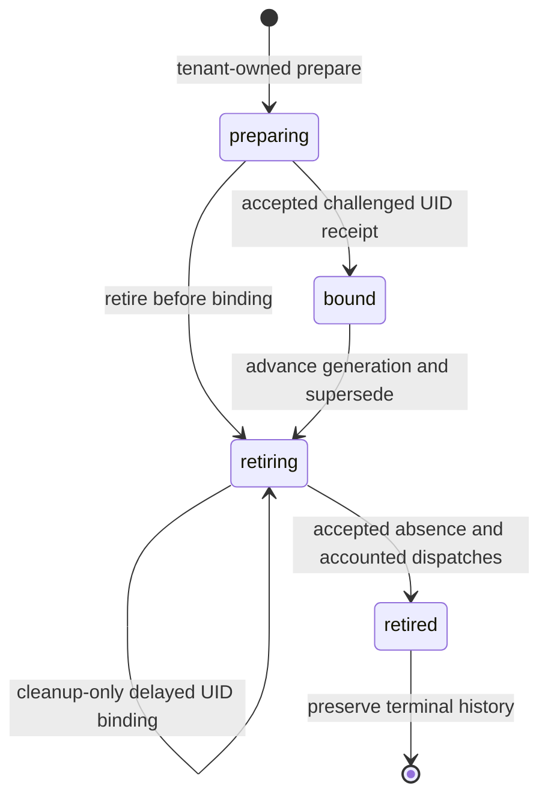

# GO-CP1 — Go-native canonical control-plane kernel E1

Assignment: `UTCP_GO_NATIVE_CANONICAL_KERNEL_E1`.
Date: 2026-10-22. Worker: OpenAI Codex CLI; requested GPT-6 / High;
role: Principal Go/PostgreSQL Control Plane Engineer / Distributed Systems Engineer.
Execution: IMPLEMENTER, with developer testing and separate read-only architecture
and security review. Independent acceptance remains a subsequent responsibility.

## Verdict and evidence boundary

**`UTCP_GO_NATIVE_CANONICAL_KERNEL_E1_IMPLEMENTED_WITH_LIMITATIONS`**.
The complete pinned verifier exited successfully against disposable PostgreSQL;
the new module, PHP compatibility oracle and existing offline foundation
regressions pass. Positive Asterisk domain fencing/restoration has not been
ported: the Go service fails closed without a trusted complete domain policy.
The receipt API conservatively retains unmatched uncertainty instead of accepting
affirmative not-applied evidence, and nested recovery uncertainty can still
require unavailable trusted evidence for forward progress. These are explicit
compatibility/recovery limitations. FreeSWITCH domain fencing/restoration remains
unsupported. This is developer-tested implementation, not independent acceptance.

The implemented slice is an isolated Go canonical kernel against existing UTCP
PostgreSQL authority. It introduces no production API, service binding, worker,
Kubernetes executor, database backfill, external effect or writer transfer.
Laravel remains operational and the behavioral reference. The selected Go-native
target is distinct from the still **PROPOSED / AWAITING OPERATOR ADOPTION**
[architecture ADR](go-native-control-plane-adr-proposed.md).

## Repository baseline and preservation

Starting branch: `main`; HEAD:
`5e028b9ab3d96f3430bf715f89d66ab19a758761`.
The starting worktree contained 24 untracked canonical-foundation and Go-native
architecture files, no tracked modifications and no staged changes. A private
SHA-256 inventory covered 1,578 existing regular Git-visible files before edits.
No reset, clean, staging, commit or push is authorized or performed for GO-CP1.
The prior preservation commit is inherited evidence, not a new commit.

Final preservation comparison, worktree count and inventory are recorded in
[verification evidence](go-cp1/verification.md) and
[changed-file inventory](go-cp1/changed-files.md). Prior reports and accepted ADRs
retain their historical meaning. The canonical RMA-E next action and accepted
V1/K5 classifications are not changed by an isolated migration implementation.
Final branch and HEAD are unchanged. All 1,578 pre-existing hashes match; 39 new
files bring the worktree to 63 untracked files, with no tracked or staged changes.

## Existing authority and implementation seam

| Existing source | Reused authority |
| --- | --- |
| [CanonicalInfrastructureService](../../../apps/api/app/ControlPlane/InfrastructureAuthority/CanonicalInfrastructureService.php) | Lifecycle, generation, intent and full-envelope claim behavior |
| [Infrastructure authority migration](../../../apps/api/database/migrations/2026_10_21_100000_create_infrastructure_incarnation_authority.php) | Immutable identity, lifecycle transitions, generation range and retained history |
| [RuntimeOperationRepository](../../../apps/api/app/ControlPlane/RuntimeOperations/RuntimeOperationRepository.php) | Existing operation IDs, status, attempts, leases, cancellation and fencing |
| [Prior canonical foundation](UTCP_GN_G2_CANONICAL_LIFECYCLE_AND_CLAIM_FOUNDATION.md) | PostgreSQL concurrency/restart and PHP/Go behavioral oracle; inherited proof limits |
| [PostgreSQL authority design](go-native-control-plane/postgresql-authority-contract.md) | New durable dispatch and challenged observation requirements |
| [Existing Go effects](../../../components/kubernetes-effects/) | Strict v1/v2/v3 schema and independent fingerprint validation; execution remains inactive |

No second operation engine is created. New dispatch and receipt rows are
subordinate evidence attached to existing operations, intents and incarnations.
Go holds no Kubernetes credentials; the intended future infrastructure-I/O role
must hold no PostgreSQL credentials. Same-language code does not eliminate that
credential boundary.

## Module and package structure

The module is [apps/control-plane](../../../apps/control-plane/README.md).

```text
cmd/utcp                     guarded disposable migration command
internal/postgres            bounded pgxpool and test-only Goose helper
internal/kernel              canonical SQL services, lifecycle, claims,
                             dispatch evidence, receipt acceptance and messaging
internal/infrastructure      closed envelope/protocol validation, cryptography,
                             mTLS handler and certificate rotation
internal/app                 authenticated transport-to-kernel composition
integration                  PostgreSQL, PHP oracle, subprocess and mTLS tests
contracts                    independent private schemas and synthetic fixtures
migrations                   one additive dispatch/challenge/receipt migration
```

Explicit constructors and consumer-owned verifier interfaces replace a generic
dependency-injection framework. The kernel imports no Kubernetes client and
opens no network listener. Infrastructure validation reuses the existing Go
component modules through local pinned replacements. `cmd/utcp` does not start an
API or worker. Contexts flow through SQL and transport calls; upstream effects
are absent from canonical transactions.

## PostgreSQL schema compatibility and transactions

The disposable verifier executes the full current Laravel migration history,
then the reviewed additive Goose SQL. Existing canonical tables, IDs, foreign
keys, JSON types, generation limits, audit trigger and operation states remain
the baseline. The [adoption contract](go-cp1/postgresql-adoption.md) separates this
test sequence from the future single-owner production DDL handoff.

`pgxpool` is bounded to eight connections, five-second connect timeout,
30-minute connection lifetime and five-minute idle lifetime. Transactions use
`READ COMMITTED` and lock RuntimeNode → incarnation → intent → operation.
Only SQLSTATE `40001` and `40P01` retry, at most three pure-database transactions;
other errors are returned. Rollback uses a bounded cleanup context. Network calls
never run inside these transactions. An ambiguous commit is recovered by durable
identity/status, not permission to repeat an external effect.

The catalog comparison protects existing columns/defaults, constraints, indexes,
triggers, functions, views, grants and selected nonsecret capability/role seed
identities before/after additive SQL. A later production adoption must additionally
verify its actual catalog drift and data invariants; a disposable catalog match
is not a production migration proof.

## Canonical lifecycle and physical identity



Preparation validates tenant/RuntimeNode and provider family, the closed immutable
configuration and image digest. It allocates a random incarnation and physical
name `utcp-<incarnation>`, generation `1`, and commits audit/outbox together.
Identical preparation keys return the same record only when inputs match.
Existing PostgreSQL constraints protect one-current-incarnation and name nonreuse.

UID binding requires authenticated exact-resource evidence. It is one-way and
cannot silently adopt a replacement UID. A delayed inert create may be bound
while retiring for cleanup; it remains retiring and cannot reactivate.
Retirement advances generation, supersedes old intent and cancels never-consumed
reservations. Consumed/unknown delivery evidence remains durable. Terminal
retirement requires complete exact absence and no unaccounted competing dispatch.
DELETE success, a matching physical name or an unauthenticated boolean cannot
complete this transition.

## Generations, fingerprints and configuration

Canonical generations remain decimal strings across JSON/service boundaries and
positive PostgreSQL signed BIGINT internally:
`1..9223372036854775807`. Exact parsing rejects leading zeros, signs, fractions,
exponents, overflow and malformed values. `9007199254740993` must remain lossless.
Allocation serializes under canonical row locks; rollback undoes its authority,
supersession, audit and outbox together.

The existing infrastructure v1/v2/v3 schemas and ordered length-prefixed
fingerprints remain unchanged. A second SHA-256 binds the entire submitted
action envelope, including its claim, deadline and resourceVersion, to one
reservation. This exact request digest is distinct from the semantic intent
fingerprint. Durable canonical intent excludes the wire claim; capability and
lease material are stored as digests only in dispatch evidence.

Configuration identity preserves the approved digest-pinned image, configuration
ID/hash and Secret-reference identity. Hashing a reference does not establish
the contents of a mutable Secret/ConfigMap. Production publication must use
verified immutable/versioned configuration, or an independently accepted content
identity protocol, before activation integration. No payload is read or exposed
by this kernel.

## Full-envelope claims and cross-version authorization

Verification resolves canonical tenant/node/lifecycle truth from PostgreSQL and
checks the exact persisted envelope, operation status, attempt, token, lease
expiry, cancellation, request deadline, incarnation, cluster/namespace/name,
UID, action, profile, current generation, fingerprint and supersession. Database
time governs expiry. There is no positive authorization cache.

| Contract | Additional canonical policy |
| --- | --- |
| v1 `admit_generation` / `set_replicas` | Bound current target; nonzero replicas require an already confirmed approved v3 projection; old versions cannot activate unbound/retiring/retired incarnations |
| v2 lifecycle | Create only while preparing; inert convergence stays zero-replica; delete only while retiring |
| v3 active projection | Bound incarnation, correct provider profile/configuration, current desired active state and exact UID |
| Asterisk fencing/restoration | Denied by default; complete provider-domain eligibility is a remaining implementation gap |
| FreeSWITCH fencing/restoration | Explicitly unsupported; Deployment projection does not imply domain capability |

Operation-type/action combinations are restricted to the existing mutation
corridors. A caller cannot turn a provisioning operation into arbitrary scaling
authority. No production claim callback route is registered.

## Durable dispatch reservation and consumption

The private contract is [utcp.dispatch.v1](../../../apps/control-plane/contracts/README.md),
separate from infrastructure v1/v2/v3. Closed schemas support reserve, consume,
result and status. Authenticated executor SAN is supplied by the transport,
not trusted from a payload field. Request sizes, concurrency, deadlines and error
projection are bounded by the isolated handler.

1. **Reserve:** lock canonical rows; verify the exact current attempt and policy;
   bind executor, full request digest, capability/token digests and expiry. A
   duplicate returns existing status, not new authority.
2. **Consume:** revalidate current authority; atomically change reserved to
   dispatching and record attempted evidence before returning one grant. A
   duplicate/lost-response retry returns status without another grant.
3. **Synthetic execution boundary:** tests model the external effect after
   consumption. The kernel executes no Kubernetes mutation and has no delivery
   retry loop.
4. **Result:** an executor may add uncertainty. Unsupported success assertions
   cannot confirm application; challenged authenticated observation is required.
5. **Recover:** reload durable state, recheck current authority and observe exact
   identity. Never refresh resourceVersion and replay blindly. Never enable a
   PHP fallback writer.

Expiry may release only a never-consumed reservation through a durable cancelled
transition. A consumed grant remains uncertain even if its worker crashed before
the synthetic effect. This deliberately sacrifices availability when delivery
cannot be established. It guarantees at most one dispatch grant per consumed
attempt, not exactly-once Kubernetes application.

### Higher-generation progress barrier

One unresolved ordinary slot and at most one recovery-barrier slot are enforced
per incarnation. The exception requires an already-bound exact UID, a current
strictly higher generation, a permitted conditional barrier action and the exact
set of blocked dispatch IDs. It rejects an unknown `create_suspended`.

While bound, permitted recovery actions are `admit_generation` and
`converge_projection`. During retirement, an exact-UID `retire_delete` may
account for recorded older non-create requests, but only a subsequent challenged
complete absence receipt establishes their containment. DELETE acceptance is
insufficient. An unaccounted request, another recovery request or an uncertain
CREATE blocks terminal completion.

After a challenged receipt confirms the newer barrier/effect or exact absence,
older dispatch records can be marked externally contained while preserving
their original intent's unknown outcome and delivery history.
Containment does not assert that an old packet was never delivered. A new barrier
that loses a Kubernetes conditional race must remain unknown/conflicted; no
automatic retry with a fresh resourceVersion is authorized.

The recovery exception is intentionally bounded to ordinary predecessors. If a
recovery-barrier dispatch itself becomes consumed/unknown, another recovery slot
is denied. Fresh challenged observation of that exact historical recovery effect
can discharge its uncertainty even after retirement supersedes its intent. This
records evidence and contains its recorded predecessors; it grants no dispatch,
does not restore bound state and does not change the current generation. Cleanup
then requires its own current retirement authority. If matching trusted evidence
cannot be obtained, uncertainty remains fail-closed; the protocol does not claim
automatic forward progress for every nested uncertainty.

No database lease can retract an in-flight request. An older request before a
newer external barrier may temporarily apply; after a verified newer conditional
barrier it cannot overwrite that protected resource version. GO-CP1 tests the
durable protocol synthetically; actual Kubernetes predicates inherit earlier
GN-G2 proof and are not newly exercised by this assignment.

## Authenticated observation receipts

`utcp.observation-receipt.v1` is challenged and Ed25519-signed. It binds trusted
issuer/key/SAN scope, audience, nonce, tenant/node, cluster/namespace/name,
incarnation, expected/observed UID, opaque resourceVersion, purpose, exact
intent/dispatch/request digest, generation/fingerprint and observation timestamps.
Duplicate/unknown JSON fields reject. Every signed field has deterministic
encoding, including explicit null replicas where inapplicable.

| Purpose | Required evidence and canonical use |
| --- | --- |
| `bind` | Fresh complete exact GET; observed ownership, inert projection digest, zero replicas and matching creation markers; records UID once |
| `effect` | Exact bound UID, matching admitted/applied markers, expected replicas and independently observed controlled-projection digest where applicable |
| `absence` | Fresh complete exact GET 404 from the trusted source; retiring identity and accounted outstanding dispatches; then terminal retirement |

Observation must start after challenge issuance. Default maximum age is 30
seconds with five seconds of future skew; expiry cannot outlive the challenge.
Challenges consume once; issuer/receipt identities are unique. PostgreSQL
rechecks current canonical eligibility under locks after cryptographic checking.
An exact-byte retry of a durably accepted receipt returns status-only success
without another lifecycle transition, audit event or outbox message. Reissued or
altered bytes do not reuse the accepted challenge. Historical receipt acceptance
is not authority to redispatch the associated operation.
Revoked/wrong keys, wrong SAN/scope, stale/incomplete/replayed evidence and target
or marker mismatches reject.

mTLS authenticates a current connection; signatures preserve issuer attribution
and evidence integrity after storage. Neither proves observation truth, trusted
observer software correctness, Pod readiness or telephony execution. No receipt
is acquired from a real cluster in GO-CP1. Synthetic issuers are test-only.

## Unknown outcomes and restart recovery

Dispatch state distinguishes reserved, dispatching, outcome unknown, confirmed
application, cancellation and external containment. The existing intent outcome
remains subordinate to the same operation history. `Unresolved` recovers the
tenant-scoped pending set after process loss. Subprocess tests kill a worker after
reservation, after durable consumption, and after a synthetic effect before its
result is recorded. Each case starts another process against the same database;
the new process cannot obtain a duplicate grant and records observation-required
uncertainty for consumed work. The synthetic effect is a temporary local marker,
not Kubernetes execution. Reserved-but-never-consumed work remains recoverable
separately. Other transaction boundaries have rollback/response tests rather
than separate process-kill coverage at every instruction.

Conservative unknown state is retained where observation cannot establish safe
resolution. Definitive not-applied recovery requires evidence that rules out a
late request, not merely a GET with old fields. Unknown create cannot use the
conditional higher-generation barrier exception: retain terminal physical
identity, inertness and cleanup-only policy until delivery is accounted for.

## Audit, outbox, inbox and idempotency

Transitions append existing C0 audit/outbox records in the same transaction,
containing only incarnation and optional operation IDs. Lease tokens, capability
material, raw action payloads and Secret content do not enter those events.
Append-only audit constraints remain enforced.

The Go service uses existing inbox consumer/message identities and payload hashes;
processing and its DB-only callback commit together. Outbox claims use bounded
leases, exact token acknowledgement and retry-safe pending state, with
`FOR UPDATE SKIP LOCKED`. Idempotency commits request fingerprint and safe result
with the DB-only transition; rollback leaves no accepted identity. No new queue
or Redis authority is introduced.

## Verification environment and results

See [exact commands and evidence classification](go-cp1/verification.md). Only
newly executed results are GO-CP1 evidence; previous Kubernetes/telephony reports
remain inherited behavioral references with their original limits.

Pinned images:

| Tool | Immutable identity |
| --- | --- |
| Go 1.25.8 SDK | `golang@sha256:4557cf171e3cdf5053a298d5171b1a5f5734d920260c25f22c79e94760eb2084` |
| PostgreSQL 17.6 | `postgres@sha256:ef257d85f76e48da1c64832459b59fcaba1a4dac97bf5d7450c77753542eee94` |
| Existing PHP test image | `sha256:9efe210fb8c8e7c90d80fce2b6916b46824f0f0428d6037dd599ec5ef1dd4d7d` |

Direct dependencies: pgx/v5 `v5.7.6`, Goose `v3.24.3`; infrastructure modules retain
their pinned Kubernetes `v0.35.3` baseline. No host package was installed.

`tests/go-cp1/verify` exited `0`. The new module passed 100 test nodes, including
19 real PostgreSQL integration tests; one subprocess-helper parent skip is
intentional. Race detection, vet, module verification, formatting and schema
checks passed. The independent PHP oracle matched three fingerprints and 21
claims; focused PostgreSQL PHPUnit passed 30 tests / 117 assertions. Prior
canonical verification passed 41 PostgreSQL tests / 232 assertions, a separate
43-test / 447-assertion SQLite runtime/identity group, and the two normal/race
mTLS bridge tests. Existing effects, observer, dedicated lifecycle and active
profile offline suites passed. Their detailed counts and conditional skips are
recorded in the linked evidence; these overlapping runs are not summed as unique
tests. No new Kubernetes or telephony runtime proof is claimed.

Cleanup verified removal of the run-owned containers, temporary volume and
network, including the nested canonical proof environment. No pre-existing
resource was targeted. Hygiene, phase-status consistency, documentation links,
new-file content checks, preservation hashes and `git diff --check` passed.

## Known baseline findings

`make runtime-engine-config-check` retains the historical assertion mismatch:
`ordinary platform workers must not carry the Kubernetes API client label`.
Accepted K5 Kubernetes API-client labels on `utcp-platform/api`, `scheduler` and
`telephony-reconciler` are rejected by an older static rule. No accepted permission,
manifest or checker is weakened. Repair belongs in a separate focused packet
with positive and negative security regressions before broader acceptance.

`make secret-scan` retains the credential-form assignment finding in
`apps/web/src/views/ExternalTrunkDetailView.vue` around line 292. It is not evidence
of a literal credential introduced by GO-CP1. A narrowly scoped scanner correction
requires separate review; no general exception is added here.

## Remaining integration and acceptance requirements

1. Port and independently verify complete Asterisk domain fence/restoration
   eligibility; keep default denial meanwhile. Do not infer FreeSWITCH support.
   The canonical subset therefore does not yet have complete positive Asterisk
   claim parity.
2. Independently review this implementation, transaction races, receipt trust,
   privilege separation and durable unknown-delivery behavior.
3. Adopt the Go-native ADR through the operator/governance record before claiming
   formal architecture adoption. Isolated implementation is already authorized.
4. Establish a trusted actual observer/IO implementation of challenge issuance,
   signed receipts, reserve/consume and safe credential/key rotation. No production
   transport or Kubernetes executor is activated here.
5. Verify immutable configuration publication and controlled historical workload
   adoption. Never fabricate existing UIDs or reuse physical names.
6. Resolve the independent baseline static-check/scanner defects before their
   relevant production gates.
7. Authorize production DDL, service wiring and writer transfer separately. All
   five mutation corridors, legacy in-flight work, external replica writers,
   credential cutoff and conditional-compatible rollback remain prerequisites.

The receipt API confirms observed application or exact absence; it does not
currently accept affirmative `confirmed_not_applied` evidence. Unmatched
uncertainty remains observation-required instead of inventing a safe negative
result. This is an explicit recovery/availability limitation, alongside the
bounded historical-recovery case described above, rather than permission for
blind retry.

These are distinct from a production deployment claim: no deployed, browser,
real Kubernetes, SIP/media or natural-live acceptance is established here.
The [next bounded assignment](go-cp1/next-assignment.md) ports and independently
verifies the concrete remaining Asterisk canonical domain-policy gap.

Current-State Ledger Impact: **NO_CHANGE_REQUIRED** for this isolated migration
packet; accepted V1/K5 and canonical RMA-E next action remain unchanged.
Phase-Status Consistency Check: **PASS**.
