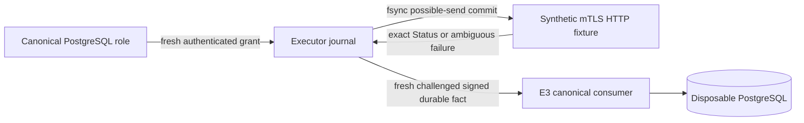

# GO-CP1 E4 — durable executor journal and trusted evidence producer

Date: 2026-10-22. Assignment:
`UTCP_GO_NATIVE_CANONICAL_KERNEL_E4_DURABLE_EXECUTOR_JOURNAL`.
Execution role: IMPLEMENTER. Requested worker/model: OpenAI Codex CLI, GPT-6,
high reasoning; professional role: Go distributed systems/security/infrastructure
execution engineer. This report records developer verification for independent
review, not independent acceptance or production readiness.

**Verdict: `UTCP_GO_NATIVE_EXECUTOR_JOURNAL_E4_VERIFIED`.**
The fifth complete pinned verifier exited 0 after all applicable implementation,
regression and cleanup gates passed. This is developer evidence ready for
independent review; it does not establish production readiness or independent
acceptance.

## Scope, repository identity and authority

Starting branch `main`, HEAD `5e028b9ab3d96f3430bf715f89d66ab19a758761`;
94 individual untracked files, zero tracked/staged changes. SHA-256 preservation
covers all 1,648 starting Git-visible regular files: 1,644 remain byte-for-byte
unchanged. Three existing untracked verifier scripts have reviewed test-budget
and package-scheduling changes, and one existing PostgreSQL test has a reviewed
contention-result correction; their original bytes are retained privately and
match the initial hashes. The packet contains 28 new files and those four modifications, with
122 final untracked files and zero tracked/staged changes. Existing runtime
source, dependencies, contracts, SQL and prior evidence remain unchanged. No
staging, commit or push is performed.

PostgreSQL remains sole canonical operation/lifecycle/generation authority. E4
adds a subordinate local executor fact journal, not another operation engine.
The executor accepts only signed synthetic grants, performs synthetic HTTPS
requests and signs durable negative dispatch facts. The canonical E3 consumer
continues independently validating evidence and committing results/audit/outbox.
No Kubernetes cluster, credential or request, live database, production PHP
writer, telephony traffic, deployment, production schema migration or writer
cutover is involved.

The Go-native target remains operator-selected. Its ADR remains **PROPOSED /
AWAITING OPERATOR ADOPTION**. Formal adoption and production authority transfer
are separate governance actions. Accepted V1/K5 classifications and canonical
RMA-E next action are unchanged. Current-State Ledger Impact:
**NO_CHANGE_REQUIRED**: this isolated experimental implementation adds supporting
developer evidence and changes no accepted phase, canonical topology, current
runtime authority or canonical next action. Phase-Status Consistency Check:
**PASS**.

## Source-backed integration requirements

The E3 [dispatch consumer](../../../apps/control-plane/internal/kernel/dispatch.go)
provides one fresh consumption grant; duplicate consume/status never grants
another send. It verifies full canonical claims and supported Asterisk policy.
[Dispatch-evidence acceptance](../../../apps/control-plane/internal/kernel/dispatch_evidence.go)
checks exact operation/attempt/dispatch, immutable target, generation/fingerprint,
issuer, fresh challenge and current canonical policy. The existing
[transport verifier](../../../apps/control-plane/internal/infrastructure/dispatch_evidence.go)
checks signatures and trusted mTLS/scope correlation. E4 preserves these contracts.

| Existing requirement | E4 producer implementation |
| --- | --- |
| Exact consumed dispatch and raw request hash | Signed immutable private handoff; separate synthetic-body hash. |
| Trusted identity and anti-substitution | Issuer/key/SAN/audience/executor checks, signed endpoint and journal ID. |
| Zero submissions and irreversible finalization | `accepted → closed` under the same shared lock as possible-send. |
| Sole exact terminal rejection | Durable `possible → api_rejected` from authenticated correlated Status. |
| Uncertain delivery | `possible` survives crash/reopen and never permits automatic replay. |
| Fresh challenged signature | Reopen/reload terminal facts, match full challenge and sign unchanged E3 payload. |
| Canonical replay/state safety | Existing E3 transaction revalidates and deduplicates evidence/audit/outbox. |

E3 supplies the actual supported code/reason whitelist. E4 does not invent an
alternative action policy, operation table or evidence consumer. E1–E3 PostgreSQL
schema, Goose dependencies, infrastructure v1/v2/v3 fingerprints and dispatch/
evidence versions stay unchanged.

## Implemented components and storage choice

The new package
[`apps/control-plane/internal/executor`](../../../apps/control-plane/internal/executor)
contains grant validation, durable journal, bounded synthetic HTTP and signed
evidence production. The new closed `utcp.executor-grant.v1` is necessary because
existing dispatch responses cannot carry an authenticated executable handoff.
Its [schema](../../../apps/control-plane/contracts/executor-grant-v1.schema.json)
and twelve shape fixtures do not alter existing contracts. Fixture signatures are
placeholders; independent Go tests generate real Ed25519 signatures.

A focused filesystem WAL avoids adding an embedded database/dependency for five
small states. The journal uses owner-private files, sequence/checksum/hash-chain
validation, a stable cross-process `flock` inode and synchronized atomic head
checkpoint. Every transition reloads durable state under the lock. Its complete
[state, transition, HTTP and storage contract](go-cp1-e4/executor-state-machine.md)
is normative for this isolated implementation.

No database transaction spans external HTTP. No executor process receives a
PostgreSQL or Redis setting. No canonical process receives Kubernetes credentials.
The journal retains safe correlation IDs/hashes, not raw operation credentials,
full infrastructure payloads or provider secrets.

## Submission, ownership and closure guarantees

After authenticating the grant, the executor takes the stable shared lock,
rechecks identity/state/deadline and commits `possible`. WAL sync, head-file sync,
atomic rename and directory sync complete before any HTTP submission. Failure at
this boundary authorizes no send. A fresh HTTP/1.1 transport performs one POST,
with no proxy, redirect loop, automatic retry/replay, keep-alive reuse or HTTP/2.

Two processes cannot both create the accepted-to-possible transition. A process
paused before it must reload state after reacquiring the lock. If closure won,
it cannot submit. If possible-send won, closure cannot claim zero submissions.
A crash after the possible commit but before sending can leave an actually unsent
request uncertain; that conservative result is intentional. This provides
at-most-one automatic submission, not exactly-once external execution.

Reserved-phase grants are rejection-only and cannot be upgraded in place.
Consumed execution requires a fresh canonically granted consumed handoff. The
canonical issuer is responsible for capping its deadline by actual lease/request
authority; the private grant is not a replacement claim verifier.

| Durable fact | Permitted evidence | What it does not prove |
| --- | --- | --- |
| Closed reserved grant; no possible transition | `pre_dispatch_rejected` | External resource absence or completed retirement. |
| Closed consumed grant; zero possible transitions; future sends excluded | `definitive_non_delivery` | Other operations never applied or resource absence. |
| One supported exact authenticated rejection durably stored | `api_rejected` | Safe UID adoption, resource absence or successful deletion. |
| Possible send, timeout/reset/cancellation/lost response | None; preserve unknown | Non-delivery or historical nonapplication. |
| Durable synthetic success | No negative evidence | Runtime readiness, canonical completion or telephony success. |
| Missing/corrupt/inconsistent journal | None; fail closed | Empty history or zero submissions. |

The fixed closed synthetic Status requires HTTP code/body code, dispatch ID,
raw-envelope hash and body hash correlation over the authenticated endpoint.
Only E3's exact supported pairs qualify. 429, 5xx, redirects, untrusted or altered
identity, malformed/oversized/duplicate/null responses and transport failures
stay unresolved. Response text cannot fabricate nonapplication.

## Signed evidence and process separation

Evidence generation reopens or reloads immutable durable facts and matches every
E3 challenge field. It uses Ed25519 and the existing serialization; current
challenge timestamps attest historical journal facts without pretending an old
response happened now. A challenge grants no send. E3 independently applies its
issuer/key/revocation, SAN/scope/audience, freshness, canonical-state, attempt,
identity, generation, lifecycle and replay checks. Repeated accepted evidence
returns idempotent status without a second result/audit/outbox transition.

The end-to-end tests launch separate executor children with allowlisted
environment/configuration containing only journal, synthetic endpoints, ephemeral
transport/signing material and grant verification key. Executor children reject
DB/POSTGRES/REDIS/KUBE/DSN settings. They obtain grants/challenges and return
signed evidence over mTLS; they never open PostgreSQL. The canonical parent owns
disposable database access and test fixture endpoints. This establishes process
configuration separation; it does not sandbox a hostile same-UID process from
host filesystem access. Ephemeral keys and credentials are not permanent evidence.

## Durability failure domains and limits

A coherent retained store survives tested process SIGKILL/reopen. Container
restart and replacement probes reconstruct durable closed state using the same
mounted files; possible-submission crash/restart is separately process-tested.
E4 does not prove arbitrary node/storage-loss or Pod-rescheduling durability. Future
production requires exclusive persistent storage, supported filesystem locking/
sync semantics, storage identity and clone/rollback fencing.

The journal rejects interrupted tails, head/WAL mismatch, checksums, sequence
errors, unsafe permissions, changed lock inode and missing files. A commit
interrupted between WAL sync and head replacement quarantines the entire store;
automatic salvage would weaken certainty. The whole-store liveness cost is
explicit. There is no auto-repair, compaction or garbage collection; a 64 MiB WAL cap
fails closed. Checksums cannot defend privileged coherent rewrite or rollback.
Do not remove/recreate a damaged journal to release historical dispatch rights.

## Developer verification results

The complete pinned command and troubleshooting path are in
[verification.md](go-cp1-e4/verification.md). The following results come from the
fifth complete run against the final source and reviewed test-only corrections.
Nested entry points repeat overlapping suites; counts are per invocation, not a
sum of unique tests. Race commands are nonverbose and are reported as command
passes rather than inventing separately printed test counts.

| Fifth complete run | Outcome / scope |
| --- | --- |
| Grant schema and public HTTP matrix preflight | Two top-level and 29 nested PASS: 12 schema cases (2 positive, 10 negative) and 17 HTTP classifications. Schema shapes do not authenticate signatures. |
| Executor journal tests | 13 top-level and 36 nested PASS; one helper skipped in ordinary invocation and exercised through real children. |
| Fresh final executor preflight normal/race | PASS, 39.124 s / 90.288 s. |
| Executor vet/module integrity | PASS. |
| Docker retained-storage probes | Five PASS: initial closure, same-container restart, replacement same bind storage, corrupt-WAL denial, missing-store denial. |
| Disposable PostgreSQL adoption | PostgreSQL 17.6, 63 Laravel migrations; repeat migration no-op; protected catalog unchanged after the two existing subordinate SQL migrations. |
| Independent PHP/Go compatibility | Fresh whole-module normal run compared three fingerprints, 21 canonical claims and `TestE2AsteriskIndependentLaravelParity` compared all 75 Asterisk decisions: 6 fencing / 1 restoration positive; 29 fencing / 39 restoration negative. PASS. |
| Fresh whole-module normal | 82 top-level and 370 nested PASS; six expected helper skips; eight embedded child PASS lines excluded. Integration 431.071 s, executor 40.730 s, infrastructure 0.633 s, kernel 0.003 s. |
| Fresh whole-module race / vet / module integrity | PASS. Race: integration 517.792 s, executor 101.512 s, infrastructure 2.101 s, kernel 1.023 s. `go vet ./...` and `go mod verify` PASS. |
| Synthetic executor → PostgreSQL E3 consumer | `TestE4JournalProducerCanonicalPostgres` PASS 12.29 s: reserved rejection 3.65 s, zero-submission closure 2.78 s, API rejection 3.33 s, ambiguous response 2.54 s. |
| Fresh E3-focused PostgreSQL recovery | 18 top-level and 50 nested PASS, one expected helper skip; 216.763 s. |
| PHP canonical / domain regressions | PHP 8.4.15 / PHPUnit 11.5.56: real PostgreSQL 30 tests / 117 assertions PASS; SQLite domain 148 tests / 1,445 assertions PASS. SQLite results do not establish PostgreSQL concurrency behavior. |
| Inherited E2 focused / whole module | Focused 10 top-level / 101 nested PASS, one helper skip, 101.908 s. Whole module 82 top-level / 370 nested PASS; six helper skips; race/vet/module integrity PASS. Normal integration 368.661 s; race integration 196.506 s. |
| Inherited E1 whole module | 81 top-level / 295 nested PASS; race/vet/module integrity PASS. Normal integration 57.104 s; race integration 392.310 s. Seven skips: six subprocess helpers plus absent E2 oracle, independently compared in E3/E2. |
| Prior Laravel canonical / PostgreSQL durability | Canonical 19 tests / 80 assertions PASS; concurrent-transaction/restart 11 tests / 115 assertions PASS; operation/audit/idempotency 11 tests / 37 assertions PASS; SQLite runtime/identity 43 tests / 447 assertions PASS. |
| Independent Go/PHP canonical mTLS bridge | Two top-level / 25 nested PASS; normal 1.737 s / race 3.302 s. Active/lifecycle packages intentionally have no tests under this bridge-only filter. |
| Offline infrastructure effects | 27 top-level / 143 nested PASS, two expected filtered integration skips; normal 1.196 s / race 4.077 s. |
| Offline observer | 21 top-level / 86 nested PASS; normal 4.606 s / race 6.173 s. |
| Dedicated Lifecycle V2 / active-profile suites | Lifecycle 15 top-level / 71 nested PASS, normal 0.620 s / race 1.931 s; active 18 top-level / 78 nested PASS, normal 0.675 s / race 1.982 s. No skips in either dedicated suite. |
| Offline PHP regressions, per invocation | PASS: 20 tests / 209 assertions; 111 / 597; repeated 111 / 597; observer 59 / 368; repeated lifecycle 20 / 209; active 20 / 267; repeated active 20 / 267. These overlapping invocations are not unique-test totals. |
| Static / schema / document packets | GN-G1 67, GN-G2 69, Lifecycle 26 and active-profile 28 task-owned files PASS; versioned schemas and fixture tests PASS. |
| Full E3/E2/E1/PHP/offline infrastructure chain | `tests/go-cp1-e4/verify` exited 0. All normal/race/vet/module, PostgreSQL, PHP, schema, mTLS, signed-evidence and offline infrastructure gates PASS. Earlier failed attempts and fixture corrections are recorded below. |
| Run-owned cleanup | E4 storage and E3/E2/E1/prior-canonical cleanup records all true; independent Docker container/volume/network ownership-label queries empty; temporary storage, private configuration and credential directories absent. Reusable tooling caches retained. |
| Repository hygiene / phase consistency | PASS: 122 changed/untracked files, zero evidence changes, status-impact=no. Final document links/whitespace and `git diff --check` PASS. |
| `make runtime-engine-config-check` | Exit 2, unchanged accepted-K5 label conflict on `utcp-platform/api`, `utcp-platform/scheduler`, `utcp-platform/telephony-reconciler`. |
| `make secret-scan` | Exit 2, unchanged Vue credential-form assignment at `apps/web/src/views/ExternalTrunkDetailView.vue:292`. Supplementary explicit repository-pattern scan of all 32 task-owned text paths, including Go: zero findings. |

Actual process-kill coverage is distinct from deterministic fault injection. The
journal suite kills processes at nine storage/closure boundaries and five
HTTP/result/signature boundaries. The inherited E3 suite independently tests
canonical before/after-commit crash windows. These are not a claim that every
one of the user's sixteen listed boundaries has a separate SIGKILL case.

Verification iterations exposed test-fixture defects, measured timeout limits
and one existing contention-test expectation:

- The first exploratory invocation stopped at the formatting guard before tests.
  A redundant focused invocation was deliberately interrupted; neither is a pass.
- The first full run timed out because the new synthetic timeout fixture waited
  for cancellation before draining its POST body. A bounded body drain repaired
  that fixture; the final 17-case HTTP matrix passed normal and race execution.
- That run's cleanup summary incorrectly tied container removal to test success.
  Independent inspection confirmed removal; the E4 helper now reports actual
  resource absence, including after downstream test failure.
- The next full module run passed 82 top-level and 370 nested checks, excluding
  eight embedded child PASS lines, with six expected helper skips. Its race run
  exceeded the inherited 240-second package budget and a fixed ten-second child
  readiness budget under concurrent durable-filesystem load. These are recorded
  failed runs, not silently replaced by the subsequent pass.
- A further complete attempt passed fresh E3 normal/race/vet/module and PHP
  gates, then stopped in the inherited E2 whole-module execution when E4's
  `api_rejected` synthetic integration child returned `ErrUncertain` after
  15.61 seconds. That helper shared a 15-second context across Init/Accept
  synchronization and HTTP. The fixture now uses a 90-second overall context
  and 30-second client/submission bounds, retaining the unchanged runtime maximum
  and grant deadline. Its synthetic grant is three minutes, capped by the actual
  canonical reservation expiry and unchanged five-minute grant maximum. It still
  records uncertainty when a deadline is exceeded;
  the correction grants neither retry nor fabricated nonapplication.
- The fourth full attempt passed E3 and inherited E2 normal gates, then E2 race
  failed `TestE2AsteriskConsumptionSerializesBeforeRetirement`: consumption
  committed, while the competing retirement correctly returned `ErrConflict`
  at the unchanged two-second database lock timeout during durable-I/O load.
  The test now accepts only that precise contention result, retries retirement
  once after confirming the consumption commit, and still requires terminal
  retirement and replay denial. The production lock/error behavior is unchanged.

Three existing verifier scripts now accept a bounded `UTCP_CP1_GO_TIMEOUT`
(`240s`, `600s` or `900s`), retaining their 240-second default; E4 selects 900
seconds for its full nested chain. The new child-test readiness budget is capped
at 90 seconds and the test deadline, and child failures are reported immediately.
Synthetic helper grants/HTTP timeouts remain inside unchanged runtime limits.
These reviewed test-only corrections change no submission ordering, protocol,
claim, evidence or production timeout. E4 also selects `GOFLAGS=-p=1` to
serialize package scheduling under shared durable-I/O load; the inherited
wrappers pass that optional setting, retaining their ordinary default. Every
within-test PostgreSQL/process race remains concurrent. The fifth complete run
passed against these corrected files. No raw logs or test credentials are copied
into permanent evidence.

Owned-resource absence was independently confirmed after all four failed
complete attempts. The first E4 cleanup summary retained an erroneous false
container-removal flag because it used the downstream test exit; that historical
record is not rewritten. The helper was corrected to report observed absence.
The later failed runs recorded successful cleanup. Their test failures remain
visible; resource removal is not inferred from a successful test exit.

## Preserved behavior and unresolved production dependencies

E4 does not add dispatch authority through evidence acceptance. It preserves
one-time canonical consumption, exact attempts/leases/generations, retirement,
supersession, immutable UID/incarnation, delayed-create tombstones, bounded
recovery slots and uncertain predecessor history. Fresh E1–E3 and independent
Asterisk parity regressions passed. FreeSWITCH domain fencing/restoration remains
unsupported; provider projection support is separate.

Inherent uncertainty after possible-send is not a correctness defect. Remaining
production work includes exclusive durable storage and archival policy, real
executor/end-to-end API authenticity/admission, trusted grant issuance wiring,
key lifecycle/credential isolation, immutable configuration publication, formal
ADR adoption, existing baseline repairs and independently reviewed writer-transfer
controls. E4 implements none of those deployments and grants no cutover readiness.

The smallest next backend implementation recommendation is the isolated
[GO-CP2 identity/tenancy compatibility E1 prompt](go-cp1-e4/next-assignment.md).
It preserves the existing PHP browser/security contract and avoids indefinitely
extending the canonical kernel. Its prompt is a recommendation, not an automatic
production authority transfer.

Complete task-owned paths are in [changed-files.md](go-cp1-e4/changed-files.md).
No accepted architecture, deployed runtime or canonical roadmap status is changed.
