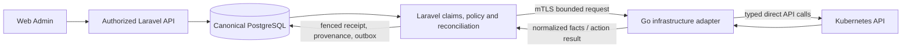

# UTCP Go-Native Infrastructure Migration Readiness E1

- Assignment: `UTCP_GO_NATIVE_INFRASTRUCTURE_MIGRATION_READINESS_E1`
- Assessment date: 2026-10-21
- Status: architecture proposal; no implementation or adoption authorization
- Worker: OpenAI Codex; requested model/reasoning GPT-6 / High; Principal Platform
  Architect / Kubernetes Control Plane Architect.

## 1. Executive verdict

**Overall architectural verdict: GO_WITH_CONDITIONS.** Recommend **Option B:
Laravel plus a bounded Go Kubernetes infrastructure adapter**, initially using
direct `client-go`, without a CRD, Operator, or independent desired-state engine.
Keep PostgreSQL, Laravel domain policy, operation claims, reconciliation, tenant
authorization, lifecycle, audit, and telephony runtime adapters authoritative.
Full Laravel replacement is **not recommended** on the evidence available.

The source demonstrates three hand-built Kubernetes HTTP clients, duplicated
authentication/error plumbing, an infrastructure placement refresh that can issue
two full cluster lists per identifiable RuntimeNode, and resource writes without
atomic UID/resourceVersion preconditions. Go provides a supported typed client
and a path to shared observation, bounded concurrent I/O, and cancellation.
Those are credible engineering benefits, not measured UTCP performance or
reliability improvements. PHP can also fix the list amplification and conditional
writes; neither defect requires a language change. Existing PHP behavior has
substantial regression coverage and historical distributed live proof.

Two architectural decisions precede a mutation implementation:

1. Adopt a separate extraction ADR under ADR-001, including process trust,
   credential ownership, and one effective writer per Kubernetes resource kind.
2. Adopt explicit external-write fencing semantics: PostgreSQL lease checks fence
   database transitions, but cannot retract an in-flight Kubernetes request.
   Decide whether bounded in-flight supersession with target-side generations is
   acceptable, or whether strict exclusion after lease expiry requires a stronger
   target-enforced mechanism. Do not label preflight checks as strict fencing.

These are substantive contract choices. Building endpoints and future test work
are ordinary delivery tasks, not additional readiness blockers. A read-only
implementation can proceed after its extraction/read contract is adopted; write
authorization requires the second decision. The unavailable Go toolchain limits
executable evidence, not completion of this source-based assessment.

## 2. Repository identity, scope, and evidence method

| Item | Baseline / result |
| --- | --- |
| Branch | `main` |
| Starting and assessment HEAD | `4ef700639c50a58933bc5a0d1e7ae08628cc4c62` |
| Initial worktree | Clean, including untracked files |
| Changes | This report and its companion proposed ADR only |
| Execution | Source inspection, two read-only specialist reviews, official upstream documentation, existing static checks and mocked PHP tests |
| Excluded | Live credentials, Kubernetes API access, cluster mutation, schema/API/runtime edits, host package installation, commits and publishing |
| Current-State Ledger Impact | `NO_CHANGE_REQUIRED` |
| Phase-Status Consistency Check | `PASS` |

The [phase ledger](../../roadmap/phase-status.md) remains authoritative. This
proposal does not change a phase classification, canonical next action, topology,
or accepted architectural direction. The proposed stages below are adoption
inputs, not a second current-state roadmap. Required consistency check: PASS;
see section 14. No historical evidence was rewritten.

Classification vocabulary: **source-inspected** means reviewed code/manifests;
**unit-tested** below includes SQLite-backed Laravel tests and mocked HTTP;
**simulated** would mean an executed Go fake-client experiment (none executed);
**integration-tested** and **live-proven** are not claims about proposed Go code.
Historical live evidence is identified separately. Documentation-only changes
cannot establish new runtime acceptance.

## 3. Verified current architecture and authority

The accepted baseline is a [modular monolith](../../decisions/ADR-001-modular-monolith.md)
with [PostgreSQL canonical and Redis transient](../../decisions/ADR-007-postgresql-canonical-redis-transient.md).
[ADR-013](../../decisions/ADR-013-control-plane-application-kernel.md) and
[ADR-016](../../decisions/ADR-016-runtime-engine-authority.md) place operations,
claims, leases, fencing, receipts, outbox/inbox, observations, checkpoints, and
reconciliation in the PostgreSQL-backed engine. Infrastructure sources do not
need fabricated RuntimeNodes or a separate durable event authority.
[ADR-014](../../decisions/ADR-014-postgresql-identity-tenancy-and-session-authentication.md)
owns identity and tenancy; [ADR-015](../../decisions/ADR-015-runtime-node-registry-authority.md)
owns the RuntimeNode registry; [ADR-021](../../decisions/ADR-021-runtime-lifecycle-and-provisioning.md)
owns lifecycle direction. [ADR-032](../../decisions/ADR-032-canonical-management-authority-and-break-glass-cli-boundary.md)
keeps management in the authorized API/Web Admin.

The ledger records V1 complete, K5A–K5E complete with K5E natural distributed live
proof, and K5F planned. RMA-A–D are complete at their recorded acceptance levels;
RMA-E–H have not started. Its canonical next action is
`RMA_E_S3_COMPATIBLE_ARCHIVE_ADAPTER_AND_DETERMINISTIC_MINIO_PROOF_IMPLEMENTATION_DESIGN`.
This proposal does not replace that action or treat Go as an R0 gate.

[ADR-024](../../decisions/ADR-024-kubernetes-host-awareness-and-telephony-aware-infrastructure-operations.md)
already contains a 2026-09-01 status clarification: its original future-facing
packet is historical scope, not evidence that K5A–E remain unimplemented.
The [K5E proof](../../evidence/k5/k5e-distributed-infrastructure-natural-live-proof.md)
records revision `3202451`, automatic five-minute scheduler-mutex expiry/recovery,
distributed placement, drain-before-cordon, rescheduling and renewed eligibility.
Desired-state reactivation remains an operator Web Admin action. It does not
prove seamless migration of an active call. The [T5 closure](../../evidence/t5/t5-phase-closure.md)
and [C3 evidence](../../evidence/c3/runtime-engine.md) preserve ownership and
durable-recovery contracts; they are historical evidence, not today's live check.

The documented canonical environment is native k3s, context `default`, node
`utcp-dev01`, edge `192.168.254.124`, platform namespace `utcp-platform`, runtime
namespace `utcp-runtime`; `utcp-local` is secondary. No live environment identity
was queried and no Kubernetes API request was made. Local `kubectl kustomize`
inside static checks renders files without contacting a cluster.

### Architecture inventory

Paths below are relative to the repository root. Complexity and benefit are
architectural estimates, not measured cost or performance.

| Component / implementation | Responsibility and authority | Durable / transient dependencies | Existing proof | Migration complexity / Go benefit |
| --- | --- | --- | --- | --- |
| `apps/api/app/Infrastructure/Kubernetes/HttpKubernetesInfrastructureClient.php` (PHP) | Raw Node/Pod list transport; Kubernetes owns facts | No DB; projected token/CA, HTTPS | Host visibility mocked feature tests | Low / typed lists, shared transport, pagination |
| `KubernetesHostVisibilityService.php`, `K5CPlacementObservationService.php` (same directory, PHP) | Tenant-aware RuntimeNode correlation, host facts, placement projection | PG RuntimeNodes, work counts, K5C observations; scheduler Redis mutex | Visibility tests; historical K5E | Medium / share one observation snapshot; keep PG and tenant mapping in PHP |
| `apps/api/app/Infrastructure/RuntimeFencing/HttpKubernetesWorkloadClient.php` (PHP) | Read Deployment, UID-owned Pods; CRUD Deployment/Service/Secret; replicas | No DB; HTTPS, projected token/CA | Workload-client and resource-writer tests | Medium–high / typed resources, conditional writes, consistent error/timeout handling |
| `KubernetesRuntimeWorkloadInspector.php`, identity resolver/validator (same directory, PHP) | Exact managed workload identity and labels | Canonical RuntimeNode metadata via caller | Fence adapter and writer tests | Medium / transport verification can move; identity assignment stays canonical |
| `KubernetesRuntimeFenceAdapter.php`, fence/restore operation handlers (same directory, PHP) | Recovery eligibility, fence provenance, disable/restore completion | PG RuntimeNodes, operations, bindings, listener leases/epochs | Fence/restore feature tests; historical T5 | High / move leaf I/O only; little justification for moving policy |
| `HttpKubernetesMaintenanceClient.php` (Kubernetes directory, PHP) | Node read/cordon, drainable Pod selection, eviction | No DB; HTTPS | Maintenance client tests | Medium / typed eviction/PDB errors and UID preconditions |
| `HostMaintenanceService.php` (same directory, PHP) | Request/audit maintenance, drain policy, wait before cordon/eviction | PG maintenance rows, runtime state; reconciliation scheduling | K5D source-contract test; historical K5E live proof | High / retain policy; no language-based concurrency guarantee |
| `apps/api/app/RuntimeProvisioning/` (PHP) | Asterisk/FreeSWITCH desired manifest projection, provision/converge/deprovision | PG configuration/lifecycle/operations, credential references | Provisioning suites source-discovered, not executed here | High / eventually move bounded Kubernetes effects, not manifests' domain decisions |
| `apps/api/app/ControlPlane/`, `apps/api/app/RuntimeEngine/` (PHP) | Canonical operations, audit, outbox/inbox, receipts, epochs, reconciliation | PG durable; Redis wakeups/locks only | Kernel checks, focused repository/state-machine tests, historical C3 | Very high / no demonstrated reason to replace |
| `apps/api/` identity, domain, API; `apps/web/` Vue/TypeScript | Authorized management, domain policy; UI projection | PG canonical; Redis transient; browser session | Existing API/UI suites, not broadly rerun | Very high / retain; Kubernetes language choice is not an API rewrite argument |
| `infrastructure/kubernetes/`, `infrastructure/docker/`, `infrastructure/compose/`, scripts/CI | Kustomize/Helm, process images, compatibility proof, validation | Kubernetes declared resources; PG volumes; container registry | Hygiene/workflow checks; manifest sources | Medium / Go adds a build, role, image, trust and deployment lifecycle |

[ADR-008](../../decisions/ADR-008-container-process-contract.md) separates API,
worker, scheduler and migration roles using the backend image. Compose is
disposable compatibility/debug tooling; Kubernetes is the integrated runtime.
`versions.env` pins PHP base 8.4.15, PostgreSQL 17.6, Redis 8.2.3, k3s
1.35.3-k3s1 and kubectl 1.36.2. Laravel is 12; the Vue/TypeScript UI is a separate
projection surface. No Go service/build or Go dependency is present in the
inspected deployment path. CI (`.github/workflows/quality.yml`,
`native-images.yml`) covers PHP/frontend, images and existing infrastructure;
a Go role would need explicit new CI ownership.

### Stale descriptions and static-check divergence

`docs/architecture/overview.md` deliberately delegates later phases to the ledger,
but its foundation Non-Goals still deny workflows implemented later.
`authority-boundaries.md` retains a T4C1-next-step reference. `SECURITY.md` scope
and `apps/api/composer.json`'s skeleton description also lag implementation.
These are descriptive residue, not authority to undo accepted behavior; they
were not rewritten in this packet.

`scripts/runtime-engine/config-check:414–424` rejects any ordinary Deployment
with `utcp.io/kubernetes-api-client=true`. Current manifests and
`RuntimeFencingManifestTest::test_only_observer_workloads_carry_kubernetes_api_client_label`
expect API, scheduler and telephony-reconciler to carry it for K5. The static
check therefore fails on this clean baseline. This is a source-confirmed guard
mismatch, not a new Go regression or evidence of a live compromise. Separately,
those K5 roles use token automount while the dedicated fencer uses an explicit
projected token and disables automount; do not assume all roles already satisfy
the same token-delivery intent. A focused security/guard reconciliation is
separate work and is not repaired here.

## 4. Exact candidate behavior and migration seams

The three interfaces are bound in `apps/api/app/Providers/AppServiceProvider.php`.
They are useful substitution seams, but their existing signatures are not a
secure distributed mutation protocol. PHP test doubles remain useful parity
fixtures; they do not establish Go equivalence.

| Candidate and PHP entry point | Current inputs, outputs, effects and errors | DB/concurrency boundary | Proposed responsibility, transport, auth, rollback and acceptance |
| --- | --- | --- | --- |
| Infrastructure lists: `KubernetesInfrastructureClient::{listNodes,listPods}`, `HttpKubernetesInfrastructureClient` | GET cluster-wide Nodes/Pods; validates list kind/items, returns arrays; 401/403 permission denied, failed/unavailable transport or malformed response; no paging/watch | None in client; caller performs PG correlation | Go snapshot RPC returns safe typed normalized facts with completeness/freshness. Observer caller mTLS and read-only SA; PHP enforces tenant visibility. Roll back read binding to PHP. Golden parity, list failure, paging, ordering and secret-filter tests |
| Host/placement projection: `KubernetesHostVisibilityService::{hosts,placementForRuntimeNode}`, `K5CPlacementObservationService::refresh` | Correlates namespace/instance/UTCP labels; sorts host conditions/addresses; distinguishes absent, unmanaged, ambiguous and unavailable; upserts PG placement | PG tenant/runtime/work counts; scheduler `withoutOverlapping(5)` | Retain PHP correlation, projection and scheduling. Go supplies one bounded shared snapshot per refresh, not one list pair per RuntimeNode. Roll back snapshot source; prove identical tenant/error/status behavior and request-count reduction |
| Workload reads: `KubernetesWorkloadClient::{getDeployment,listOwnedPods,inspectResource}` | Deployment read; Pod→ReplicaSet→Deployment controller UID chain; rolling ReplicaSets included, siblings excluded; Asterisk inspector validates exact labels; optional absent reads differ from target mismatch | No client DB; resolver uses canonical namespace/deployment, not persisted Deployment UID | Go direct reads + minimal normalized facts; retain family-specific validation at PHP policy boundary and repeat ownership check in Go. Read-only rollback; exact UID chain, wrong owner, replacement UID, terminating/terminal and readiness parity |
| Deployment execution: `scaleDeployment`, `applyDeployment`, `deleteDeployment` | Nonnegative replicas via merge PATCH `/scale`; GET/create or owned-label merge PATCH; delete after GET/ownership; no atomic UID/RV preconditions | No client DB; many operation handlers share this client; caller claim does not fence Kubernetes | Go bounded Deployment effects only after G0 decision. Executor-only mTLS; scoped write SA; conditional identity/generation checks. Cut over all Deployment writers together, not just fence handler. Rollback by quiesced credential/binding transfer. Race, unknown-outcome, repeated intent and full fence/restore/provision tests required |
| Service/Secret execution: same interface apply/delete methods | Ownership checks; Service immutable allocation fields stripped; Secret result contains metadata/type, never data/stringData; generic inspect is restricted | Credentials/desired manifests remain PHP-owned; transport client has no DB | Defer until Deployment corridor is proven. If moved, typed fixed-purpose RPC, no raw Secret response/log/hash exposure; retain separate PHP credentials only for unmigrated resource kinds. Exact redaction, immutable fields, foreign-owner and idempotent-delete regression |
| Maintenance transport: `KubernetesMaintenanceClient::{node,cordon,drainablePods,evict}` | Node GET, unschedulable patch; identity-subject Pod list excludes DaemonSet/mirror/terminating/terminal; sorted output; eviction 404 success, 409/429 blocked; other failures unavailable, 401/403 denied | No client DB; service has PG maintenance state but no visible per-row kernel claim in `reconcileDue` | Later separate Node/eviction slice; never treat maintenance as already kernel-fenced. Require canonical authorization/claim seam first. Go executes supplied effects only; rollback transfer of Node/eviction rights, preserve PDB and UID tests |
| Telephony-aware fence/restore and maintenance handlers | Drain work before infrastructure effects; recovered-node guard; fence provenance; zero desired/status/available replicas AND no owned Pods; restore also requires fresh listener/source epoch and readiness; audit/desired-state transitions | PG policy, generation, bindings, lease, receipts, lifecycle | Retain PHP. No Go disable/reactivate/restore/drain decision. Only leaf infrastructure calls cross RPC. Existing handlers remain completion authority; rollback never fabricates a successful outcome |

Workload client errors currently map 401/403→`permission_denied`, 404→
`target_mismatch` except documented optional/idempotent paths, 409→
`fence_in_progress`, 422→`invalid_request`, 408/429/5xx/transport→
`unavailable_to_control`, malformed→`failed`. Maintenance intentionally maps
429 with 409 to blocked/conflict. Preserve per-method behavior first; publish
any intentional remapping as a versioned compatibility decision. Do not flatten
all conflicts into `FailureClass::Conflict`, whose kernel retry policy differs.

Source seams include `ManagedRuntimeWorkloadConvergenceOperationHandler`,
managed Asterisk/FreeSWITCH provisioning and deprovisioning handlers, and
`routes/console.php`'s dedicated infrastructure-worker operation selection.
Relocating one caller while leaving another Deployment writer active would not
be a safe ownership cutover.

## 5. PHP versus Go against UTCP requirements

The following conclusions combine repository inspection with upstream capability
documentation. Predicted UTCP improvements remain hypotheses until measured.

| Requirement | Current PHP / practical improvements | Go assessment and limitation |
| --- | --- | --- |
| Native API and typed resources | Arrays + explicit HTTP validation; supported API subset works and is tested | `client-go` typed Core/Apps/Policy clients remove much handwritten transport/resource plumbing; schema types do not prove UTCP ownership |
| Watches, RV recovery, resync | Full lists, no watch/paging; shared paged snapshot can improve PHP | Reflector/informer machinery handles list/watch lifecycle; cache resync is reprocessing, not a fresh server read. Add only when measured need justifies stale-cache handling |
| Reconcile/workqueue | PG engine already owns durable retry, idempotency and recovery | Go queues are useful transient I/O scheduling; consuming desired state independently would duplicate authority |
| Concurrency and cancellation | Separate workers and HTTP timeouts; no shown shared cancellation tree | Context propagation and goroutines simplify bounded parallel reads; cancellation does not undo a server-accepted mutation |
| Long-running connections | Existing telephony listeners have recovery contracts; Kubernetes clients use requests | Go suits persistent watch connections; reconnect, liveness, leak and token-rotation tests still required |
| Election/lease/fencing | PG transactional claims, equality token, expiry; scheduler Redis mutex | Kubernetes leader election is not a replacement for PG claims or external-write fencing; no new election initially |
| Partition/restart | Durable canonical retry and unknown/degraded observations already exist | SDK errors/timeouts improve consistency; process restart loses Go memory and must recover by canonical intent plus fresh Kubernetes reads |
| Scaling and ownership | Exact managed names/labels, UID chain; unconditional scale and read-then-write checks | Conditional UID/RV writes improve safety, also possible in PHP; Kubernetes still owns scheduling and Deployment reconciliation |
| SSA/conflicts | Merge PATCH, not SSA; preserve allocated Service fields | Typed apply builders exist. SSA field ownership is not lease fencing; defer SSA until field map and rollback ownership transfer are explicit; never force conflicts silently |
| Observability | Existing metrics/audit/log paths and operation correlations | Add bounded-cardinality RPC/client metrics, Go profiles and cancellation counters; another process adds debugging work |
| Packaging/resources | Established PHP image/process contract; no new build cost | A compiled binary can simplify an adapter image, but client-go adds dependencies and caches consume RAM. No measured CPU/RSS/image-size advantage here |
| Security/maintenance/versioning | Tested TLS/token reread, least-privilege roles with distinct corridors | Maintain pinned aligned API/apimachinery/client-go versions, Go security updates and SBOM; new mTLS/service identity surface; no automatic CVE advantage |
| Implementation/regression | Lowest immediate risk to retain current code; fixes remain viable | New wire protocol, PHP mapper and effect semantics are more work than swapping an HTTP library; preserve existing suites |
| Multi-cluster/hybrid | Current identity namespace/deployment has no canonical cluster ID or persisted Deployment UID | SDK can hold separate clients; durable cluster identity, credentials and routing need a separate authorized contract. No multi-cluster support implied; deployment-neutral RuntimeNode remains |

Upstream sources inspected on the assessment date:

- [client-go README/version relationship](https://github.com/kubernetes/client-go/blob/master/README.md):
  typed clients and version alignment; do not select `latest` blindly.
- [cache package](https://pkg.go.dev/k8s.io/client-go/tools/cache):
  reflector/context/list-watch primitives. [API concepts](https://kubernetes.io/docs/reference/using-api/api-concepts/)
  define resourceVersion, conditional changes, pagination and expired-watch recovery.
- [controller-runtime FAQ](https://github.com/kubernetes-sigs/controller-runtime/blob/main/FAQ.md)
  explicitly treats cached observations as potentially stale.
  Its [README](https://github.com/kubernetes-sigs/controller-runtime/blob/main/README.md)
  defines the controller library and version compatibility expectations.
- [leader election package](https://pkg.go.dev/k8s.io/client-go/tools/leaderelection)
  explicitly disclaims a fencing guarantee.
- [Server-Side Apply](https://kubernetes.io/docs/reference/using-api/server-side-apply/)
  explains field-manager conflicts and ownership transfer; these are distinct
  from domain authorization and stale-operation exclusion.

**Library decision:** direct `client-go` first. It supports synchronous typed API
requests without starting an informer, manager, workqueue, CRD or leader elector.
`controller-runtime` is appropriate if a later adopted design actually needs a
watch-driven infrastructure controller, cache lifecycle and reconcile manager.
Its use does not require a CRD, but those abstractions add little to the initial
bounded RPC adapter and can obscure the existing PG engine's authority.

## 6. Alternatives and decision matrix

Ratings are comparative design judgments, not benchmark scores. Effort includes
contract and regression work; reliability means achievable confidence at cutover.

| Option | Coherence | Implementation / testing | Reliability outlook | Operations / security | Migration risk |
| --- | --- | --- | --- | --- | --- |
| A: retain PHP, improve HTTP integration | Excellent fit with current accepted monolith | Low–medium / existing suites plus new conditional-write tests | Strong current evidence; shared snapshots fix amplification; custom watch support would be costly | Lowest added deployment/trust cost; PHP dependencies remain | Low |
| B: Laravel + Go observation/execution adapter | Strong with adopted extraction contract; one policy engine | Medium / cross-language fixtures, transport and effect tests | Best bounded route to typed Kubernetes integration; no measured reliability gain yet | One extra build/process and mTLS lifecycle; separable SA rights | Medium, bounded by resource-kind cutover |
| C: Go-native infrastructure reconciliation service | Coherent only with explicit PG intent/receipt ownership and no competing policy | High / durable dispatch, reconciliation race, cache and recovery proofs | Potential benefit for high-rate watches/many clusters; current scale need unmeasured | Additional persistent service lifecycle, leader/caches and reconciliation ownership | High; easiest way to create a second engine |
| D: progressive full backend Go rewrite | Can be coherent eventually, but no demonstrated need to replace domain/kernel | Very high / identity, tenancy, API, audit, lifecycle and telephony equivalence | Long proof reset; language choice does not solve distributed authority | Dual-stack migration for a long period, large security review | Very high, unjustified now |

Select B because Kubernetes-specific integration can acquire maintained SDK
primitives without relocating the strongest existing contracts. A remains a
credible fallback if G1 shows no operational benefit relative to its extra
process/trust cost. C is rejected as the initial target because there is no
demonstrated need for a second durable reconciliation loop. D is rejected as a
current objective independently of the bounded Kubernetes recommendation.
In-process FFI is rejected for runtime/toolchain coupling; a child binary would
avoid a network endpoint but retain PHP's effective Kubernetes credentials and
complicate per-request process supervision. A narrow authenticated RPC role is
the recommended extraction, subject to ADR adoption and operational proof.

## 7. Recommended logical architecture and ownership



Go owns transport execution, normalization, request admission limits and
Kubernetes-side precondition validation. It owns no business table, durable work
queue, tenant policy, desired-state computation or automatic RuntimeNode state
transition. Kubernetes remains workload/placement authority; Asterisk,
FreeSWITCH, Kamailio and rtpengine retain their live execution authorities.
Redis remains transient. A Go action result is not operation completion.

Proposed future ownership: `apps/infrastructure-adapter/` (Go module, typed
transport and normalization, platform/infrastructure owners),
`contracts/infrastructure-adapter/v1/` (language-neutral schemas and sanitized
golden fixtures, jointly reviewed by API/kernel and infrastructure owners), PHP
client implementations behind existing interfaces, dedicated image/CI ownership
under existing infrastructure conventions. These paths are proposals; none are
created by this packet. Start observer and executor as distinct process roles
and ServiceAccounts even if built from one binary. No public ingress or operator
management interface is added.

## 8. Detailed PHP/Go boundary contract

### Requests, results and durable delivery

Use versioned internal HTTPS JSON RPC over mutually authenticated TLS:
`POST /internal/v1/observations:snapshot` and, only after write adoption,
`POST /internal/v1/actions:execute`. Not a generic Kubernetes proxy: fixed action
enums, resource kinds and typed bodies; no arbitrary URL, shell command,
unvalidated YAML, bearer-token forwarding or browser-callable route.

Observation requests carry request/correlation IDs, selected fixed cluster
authority and bounded resource scope. Results carry schema version, observation
ID, capture start/end, per-list RV, completeness and freshness, normalized facts
or explicit unavailable status. Node and Pod lists are not an atomic
cross-kind snapshot. PHP must retain absent versus unknown/partial distinction.
The RPC is internal platform evidence; PHP authorizes and filters every tenant
response. Go must not infer a tenant from a caller-supplied label.

Mutation envelope fields: schema version; operation, request, correlation,
causation and attempt IDs; caller role; tenant ID or explicit platform scope;
RuntimeNode ID when applicable; canonical configuration/domain generation;
action and canonical intent fingerprint; namespace/kind/name and expected UID
plus opaque resourceVersion; absolute desired effect; deadline; current claim
authorization reference and lease expiry. Lease tokens/auth proofs are sensitive
and excluded from logs. Cluster selection is fixed to the current authority;
introducing durable multi-cluster identity requires a separate approved change.

The current `RuntimeOperationRepository` issues random equality lease tokens,
not monotonic epochs; `assertFence` validates token/expiry for database
transitions. `CommandWorker::operationArray` does not currently forward a claim
token/expiry to a remote executor. A new claim-aware seam is required; simply
serializing the existing handler array would omit critical authorization.

Delivery sequence:

1. Authorized API persists desired intent/operation using existing services.
2. Existing PHP worker claims it in PG, resolves tenant/node/configuration,
   checks policy and live claim, and invokes Go with a bounded authorization.
3. Go validates mTLS role, envelope, deadline, ownership and current claim via
   a narrowly authenticated PHP verification callback. If verification is
   unavailable, reject new mutations. A signed short-lived grant alone cannot
   detect revocation; do not silently substitute one.
4. Go performs the conditional effect and returns operation/attempt IDs,
   request fingerprint, target UID/RV, observation time, effect classification
   and safe facts. `accepted`, `applied`, `already_satisfied`, `unknown_outcome`
   and terminal/error classes must be distinguishable.
5. PHP validates correlation and current claim, then persists normalized
   result/provenance/receipt and outbox through the established engine. Any
   infrastructure observation source uses existing source lease/epoch/checkpoint
   contracts. Late results cannot complete a superseded operation.
6. PHP adjudicates readiness and lifecycle completion from required observations;
   Go does not declare a RuntimeNode ready, drained, disabled or active.

Go does not read PG operation tables, consume the canonical queue independently,
persist results to Redis as authority, or resume business operations on restart.
If the RPC response is lost, PG retains pending/uncertain work; a subsequent
claim performs fresh observation before safe re-execution.

### External-write fencing: decision that must not be hidden

Preflight lease checks, mTLS, one replica and context cancellation do **not**
strictly fence a request that is paused after authorization or already accepted
by the API server. Kubernetes RVs are opaque concurrency tokens, not ordered
UTCP fencing epochs. An operation's attempt count is not a target-global epoch.

Recommended contract for adoption: introduce a PG-issued monotonic
**target-scoped infrastructure generation**, with an effect fingerprint carried
on the managed resource. This requires separately authorized durable contract
work; the current schema is not changed or presumed sufficient. Every competing
Deployment writer must participate. Conditional patches must test UID, RV and
the admitted generation, and atomically update the effect and marker. Fresh
reads handle conflicts; never retry by dropping preconditions. An old request
prepared before a newer admitted barrier must fail after that barrier commits.
Duplicate requests with the same admitted generation and fingerprint return
observed satisfaction; different intent at the same generation is a conflict.

This provides ordering **after the newer Kubernetes barrier is acknowledged**,
not atomicity between PG lease expiry and a Kubernetes write. An earlier request
may commit before that barrier. Hold canonical activation/eligibility and report
uncertainty until supersession/observation resolves. If strict no-write-after-PG-
expiry is required, this design is insufficient: a separately adopted target-
enforced admission/fencing design is needed. This report does not introduce one.
G0 must accept the bounded in-flight semantics or select the stronger design.

Replica changes may need conditional Deployment PATCH with the marker, replacing
the existing `/scale` patch; whether the chosen API can atomically enforce all
conditions must be proved against a real API server before mutation cutover.
Do not assume annotations on a Scale response are durable Deployment markers.
Deletion requires UID/RV preconditions; delete/recreate and initial-create/name
reuse require explicit generation/tombstone policy, not a label-only assertion.
Unknown create/delete outcomes are observed before retry; Kubernetes does not
promise exactly-once execution. These are contract acceptance cases for G0/G2.

### Ownership, error parity and security

Use canonical namespace/name binding and current Deployment UID; preserve
Pod→ReplicaSet→Deployment UID traversal, exact UTCP/runtime labels and provider-
specific checks. Refuse foreign resources and replacement UIDs; never derive
ownership from a name prefix. Persisted immutable UID binding or authorized
rebind needs explicit canonical contract work. Go cannot make that decision.

RBAC and network changes are future authorized work. Observer needs only current
Node/Pod get/list (and necessary workload reads), without writes or Secrets.
Executor rights are namespace- and resource-specific. Current roles lack watch
and update verbs; SDK convenience must not silently broaden them (`UpdateScale`
is not equivalent to current PATCH permission). Prefer projected, rotating
ServiceAccount tokens with CA validation; no automatic local kubeconfig or
credential fallback. Separate observer and executor client certificates and
caller identities; admission binds the canonical subject/action, not a trusted
tenant header. Use existing credential-reference machinery for Secret actions;
never include Secret data, env values, volumes, raw Pod specs, annotations,
tokens or Kubernetes response bodies in logs/results by default.

Normalize Node UID/name, sorted approved conditions/addresses, capacities,
allocatable, topology, taints and unschedulable; normalize Pod namespace/name/UID,
node, phase/readiness, deletion state, controller UID and necessary image facts.
Current host facts expose labels: use an explicit compatibility-approved set,
not an unnoticed field removal. Safe minimal facts still include internal
addressing: they remain authorized internal data. Secret outputs remain metadata
and type only. Test arbitrary annotation/env/Secret sentinels never escape.

Keep method-specific error mapping from section 4. Add internal reason/retry-
after/unknown-outcome fields without leaking server messages; PHP maps them into
existing exception and operation contracts. 403 fails closed; 409 re-observes and
returns control to canonical retry, not an unbounded local loop. Eviction 429/PDB
blocking is not transport outage. Backoff and durable retry stay in PHP.

### Deadlines, pressure, restart and observations

Preserve current 2-second connect/5-second API-request budgets initially (workload
client also has bounded configurable limits up to 30 seconds). Propagate the
shortest RPC, operation and lease-margin deadline via context; distinguish
timeout before send from unknown outcome after send. Never claim cancellation
rolls back a Kubernetes action. Initial tuning proposal, subject to G1 measures:
4 concurrent read calls, 1 in-flight effect per resource, queue cap 100,
client QPS 5/burst 10, explicit overload response. Local serialization is only
backpressure, not cross-replica fencing. No durable Go queue or independent
mutation retries; shutdown stops admissions, cancels requests and leaves
ambiguous outcomes for PHP recovery.

Start with paged direct lists/GETs and one shared snapshot per PHP refresh;
this reduces repeated list requests without watch rights or cache freshness
risks. Never present a partially paginated list as complete. G1 records request
count, latency, CPU/RSS, error rate and observation age against the PHP baseline.
Only then evaluate informers. A later watch design must wait for cache sync,
mark disconnect/expired RV explicitly, relist on expiry, bound observation age,
recover token rotation, and use direct reads for mutation preconditions and
completion-critical facts. A resync callback is not fresh live proof. Go restart
clears caches; initial unavailable stays unavailable until a complete read.

Expose request/error/timeout/queue/observation-age counters and histograms with
bounded labels; operation IDs belong in redacted traces/logs, not metric labels.
Do not expose pprof publicly. No new Prometheus/browser/live proof is claimed.

## 9. Duplicate-writer prevention, cutover and rollback

The first write corridor should cover **all Deployment mutations in
`utcp-runtime` through the workload-client seam**: provisioning, convergence,
scale/fence/restore and deletion. This is one resource-kind corridor, not one
handler. Services/Secrets may remain PHP-owned initially because they are
distinct resource kinds. Node maintenance/eviction stays PHP-owned until its
own claim and policy contract is proved. Go does not automatically cordon,
drain, restore replicas, reactivate runtimes, or scale by capacity metrics.

Cutover requires quiescing canonical dispatch for the corridor, resolving
in-flight/unknown outcomes, establishing generation/UID baselines, verifying the
new path in a controlled test, transferring the PHP dependency binding, and
removing PHP's effective Deployment write rights. Merely stopping a worker or
moving `/scale` while leaving full Deployment PATCH elsewhere is insufficient.
Verify no other ServiceAccount/break-glass automation remains an ordinary writer.
No dual-write shadow mode or automatic fallback on Go failure. Read-only shadow
comparison is safe and does not transfer authority.

Rollback quiesces Go admissions, resolves in-flight outcomes, transfers the
barrier/identity contract, removes Go write rights and restores the approved PHP
binding/credentials. PHP must support the new conditional-generation contract
before rollback is viable; restoring the old unconditional binary is not safe.
Keep lifecycle history and provenance. Both directions require explicit runtime
authorization, observed RBAC cutoff, failure/restart proof and ledger updates in
their implementation packets. This assignment performs none of those actions.

## 10. Bounded feasibility assessment

`go version` failed with `go: command not found`. No Go toolchain, package or
container image was installed/downloaded to work around that condition. No Go
prototype, module, lockfile, binary or disposable fixture was created. **Go
execution, compilation and fake-client behavior are NOT VERIFIED.** There is no
simulated Go pass to report; source-based readiness is the permitted fallback.

Candidate spike pin: aligned `k8s.io/client-go`, `k8s.io/api` and
`k8s.io/apimachinery` **v0.35.3**, matching the repository's k3s minor/patch
family, not a claim that this is the latest security patch. The inspected
[v0.35.3 module](https://raw.githubusercontent.com/kubernetes/client-go/v0.35.3/go.mod)
requires Go **1.25.0**. Select a maintained patched toolchain and audit dependency
updates at execution time; record exact versions. No controller-runtime version
is selected because it is not a dependency of the recommended initial design.

The next disposable experiment, outside deployable source directories, must:

| Experiment | Required assertion / proof limit |
| --- | --- |
| `fake.NewSimpleClientset` Nodes/Pods with shuffled fixtures | Stable sorted normalized facts, explicit unavailable versus empty, no sensitive sentinel fields |
| Bounded Deployment action with fake reactors | Exact namespace/UID/labels, absolute replicas; repeated same request converges, changed fingerprint conflicts |
| Deadline/cancellation | Custom blocking reactor obeys context; also `httptest` transport checks cancellation/timeout since fake clients need not model network cancellation |
| API failures | Inject 403, 409, 429, 5xx, malformed/partial reads and ambiguous post-send timeout; verify per-method PHP mapping |
| Generation/race simulation | Delayed old request, newer barrier, duplicate and replacement-UID cases; identify which server invariants fake reactors themselves implement |

Proposed commands, **not executed**: `go version`, `go test -race -count=1 ./...`,
`go vet ./...`, module/dependency vulnerability audit using the chosen pinned
tooling. Fake clients do not prove API validation, SSA, admission, real RV
conflicts, RBAC, eviction/PDB behavior, token rotation, or distributed fencing.
A separately authorized real API integration environment is required later;
do not create a cluster as part of this assignment. Lack of a spike means the
recommendation rests on SDK/source suitability, not measured binary efficiency.

## 11. Proposed migration sequence and objective gates

`GN-G0`–`GN-G5` are proposal-local identifiers; they are not adopted roadmap
phases and do not rename V1, K5, RMA or any accepted next action.

| Stage | Scope / dependencies / exact authority change | Tests, live proof and acceptance | Rollback / benefit / remaining risk |
| --- | --- | --- | --- |
| GN-G0: contract and ADR adoption | Finalize versioned wire/identity/error contract, in-flight semantics, durable target generation and UID/create/delete policy; adopt extraction ADR through maintainer decision. No runtime authority changes | Cross-language golden fixtures; race timelines; exact current caller/RBAC cutoff map; executable disposable spike when Go available. Gate: explicit acceptance of external fencing semantics and rollback compatibility; schemas resolved without inventing new business authority | Withdraw proposal; no runtime impact. Benefit: executable bounded design. Risk: strict fencing may require a different target mechanism |
| GN-G1: read-only observer | Depends on approved read extraction contract. Implement direct client-go snapshot and PHP mapper; isolated read-only SA. PHP retains scheduler, tenant correlation and PG projection; no mutation endpoint/rights | Go fake/HTTP tests, existing PHP visibility and K5C regressions; controlled live parity on authorized canonical environment, token rotation/partition/restart/freshness. Gate: normalized parity, no secret escape or tenant regression, bounded complete paging, list-pair amplification removed, measured process/resource cost acceptable | Restore PHP read binding; remove observer role. Benefit: typed transport/shared snapshot. Risk: extra process availability and partial-snapshot semantics |
| GN-G2: Deployment execution adapter | Depends on adopted write semantics and canonical claim/generation contract. Build Deployment create/conditional patch/replica/delete RPC behind inactive integration seam; PHP keeps all policy and PG results. No production cutover | Fake races/error parity and claim rejection; real API integration for atomic marker/effect, RV/UID conflicts, delete/recreate, unknown outcomes and authorization. Gate: stale generation cannot alter newer admitted state; every lifecycle caller covered; PHP rollback path speaks same contract. Record precise lease-expiry limitations | Leave current writer active, Go unprivileged in deployed runtime. Benefit: conditional typed execution. Risk: kernel seam/schema changes require separate authorized implementation packet |
| GN-G3: controlled Deployment writer cutover | Depends on G2, operator-authorized live window and preserved V1/K5 baseline. Transfer all workload-client Deployment writes and effective credentials; other resource kinds retain named owners | Prove old PHP denied writes, Go authorized only intended kinds, restart/partition/replay/supersession and rollback; rerun fence/restore/provision, ownership, scheduler recovery and distributed K5 maintenance corridor with disposable approved targets. Gate: one effective writer and unchanged domain readiness/provenance; no active-call migration promise | Quiesce/resolve/barrier/transfer back using compatible PHP; never concurrent fallback. Benefit: one production Kubernetes SDK writer. Risk: cutover and credential gaps. Service/Secret and Node/eviction extraction require subsequent bounded packets, not implied permission |
| GN-G4: separate runtime integration evaluation | Depends on measured G1/G3 results. Evaluate ARI, ESL and event listeners independently; no authority change by this stage's proposal | Compare connection/recovery/event ordering/epoch and memory metrics; preserve T4/T5 and recording contracts. Gate: capability-specific evidence and separate ADR before any extraction | Retain current adapters/listeners. Benefit: decide from persistent-I/O evidence. Risk: provider semantics, call integrity and secret exposure |
| GN-G5: backend modernization decision | Depends on operational evidence, maintenance cost and product need. Reassess retained Laravel API/domain/kernel; no presumption of replacement | Quantify observed defects, delivery and ops cost; identity/tenant/audit/API compatibility strategy and explicit acceptance before any broader migration. Gate: demonstrable benefit greater than proof reset | Keep hybrid architecture. Benefit: evidence-based future choice. Risk: rewrite cost and long dual ownership |

Later implementation packets must reconcile the canonical ledger when adoption,
phase classification, deployment authority, proof or canonical next action
actually changes. Preserve historical V1/K5 evidence; new results supplement it.

## 12. Regression, security and operational risks

Primary risks are stale writes despite expired PG leases, duplicate effective
writers, identity reuse across delete/recreate, source/cached facts mistaken for
readiness, lossy cross-language quantity/time/error conversion, Secret transport,
new mTLS rotation failures and a Go service outage blocking canonical workers.
Ownership labels alone are insufficient. PG row leases and local Go mutexes
address different scopes. Current maintenance reconciliation must not inherit
kernel fencing guarantees by assumption.

Required regression coverage spans exact Pod ownership chains and rollover,
foreign labels, recovered-node guard, stale/wrong-node/configuration rejection,
fence self-scale provenance and restart recovery, replica restoration source,
fresh listener epochs, zero-work drain ordering, PDB refusal, tenant scoping,
unknown-versus-absent, redaction and append-only audit/outbox behavior. Preserve
the existing API/UI/CLI management boundary. No runtime capacity autoscaler,
CRD authority, Redis canonical queue, manual reconciliation endpoint or hidden
fallback is introduced.

No CPU, memory, throughput, HA, browser, Prometheus, multi-cluster, Go race,
external fencing or live compatibility claims are established here. PostgreSQL
concurrency tests, full PHP/UI suites and provider live corridors were not rerun.
Those omissions are proportional to a documentation-only architecture packet.

## 13. Proposed ADR and exact adoption requirements

The companion [proposed ADR](go-kubernetes-infrastructure-adapter-adr-proposed.md)
is **PROPOSED / NOT ADOPTED**, intentionally outside the numbered accepted ADR
series. It proposes a narrow exception to ADR-001's deployment boundary, not a
replacement for ADR-007/013/014/015/016/021/024/028/032. No accepted ADR was edited.

Maintainer adoption must select the process/trust contract, approve explicit
fencing and immutable-identity semantics, authorize any durable schema work in
its own implementation scope, and assign one resource-kind writer with a
credible credential cutoff/rollback. Then allocate a repository ADR number and
update affected canonical architecture/ledger references in that adoption
packet. Approval of a read-only observer does not approve mutations or a full
backend rewrite. Go toolchain availability is an execution prerequisite, not
an operator architectural decision. No operator prerequisite is needed to
complete this assessment: **None.**

## 14. Validation, exact commands and results

| Executed command / check | Outcome and supported claim |
| --- | --- |
| `git status --short`; `git branch --show-current`; `git rev-parse HEAD` | Initial clean tree; main; HEAD recorded in section 2 |
| `go version` | Failed: command not found. No executable Go evidence |
| Host PHP version / host `vendor/bin/phpunit` attempt | PHP 8.5.4; host vendor symlink points to unavailable `/var/www/html/vendor`; PHPUnit could not open. Environmental test-runner issue, bypassed with existing test image |
| `make repository-hygiene phase-status-consistency-check workflow-check` | PASS; repository rules, ledger consistency and pinned workflow references |
| `make control-plane-config-check runtime-engine-config-check` | Kernel static check PASS; runtime-engine check FAIL at Makefile:546 on K5 Kubernetes API labels, diagnosed in section 3; no repair in scope |
| Network-isolated PHP container command below | PASS: **71 tests, 444 assertions**, PHPUnit 11.5.56, PHP 8.4.15, 3.489 seconds. Current source mounted read-only; preexisting image supplies dependencies |
| Final `make repository-hygiene phase-status-consistency-check workflow-check` | PASS; consistency reports `changed=2, evidence=0, status-impact=no` |
| Python relative-link check on both proposal documents | PASS: 17 local links resolve |
| `git diff --check`, plus `git diff --no-index --check /dev/null` for each new document | No whitespace errors after removing Markdown hard-break spaces; no-index returns 1 for new-file differences with no error output. Ordinary diff checks alone do not inspect untracked files |
| `git diff --cached --stat`; `git status --short` | Nothing staged; only the two new proposal documents, no runtime changes |
| Final read-only architecture review | PASS: canonical authority, delayed-write guarantee, complete Deployment writer cutoff and compatible rollback reviewed; no material corrections required |

Exact successful focused test command (no Kubernetes credentials or database
service; SQLite in memory, HTTP mocks, no container network):

```bash
docker run --rm --network none --entrypoint php \
  -e APP_ENV=testing -e DB_CONNECTION=sqlite -e DB_DATABASE=:memory: -e DB_URL= \
  -e CACHE_STORE=array -e QUEUE_CONNECTION=sync -e SESSION_DRIVER=array \
  --mount type=bind,src=/home/grimange/Documents/projects/unified-telephony-control-plane/apps/api/app,dst=/var/www/html/app,readonly \
  --mount type=bind,src=/home/grimange/Documents/projects/unified-telephony-control-plane/apps/api/tests,dst=/var/www/html/tests,readonly \
  --mount type=bind,src=/home/grimange/Documents/projects/unified-telephony-control-plane/apps/api/config,dst=/var/www/html/config,readonly \
  --mount type=bind,src=/home/grimange/Documents/projects/unified-telephony-control-plane/apps/api/database,dst=/var/www/html/database,readonly \
  --mount type=bind,src=/home/grimange/Documents/projects/unified-telephony-control-plane/apps/api/routes,dst=/var/www/html/routes,readonly \
  --mount type=bind,src=/home/grimange/Documents/projects/unified-telephony-control-plane/apps/api/phpunit.xml,dst=/var/www/html/phpunit.xml,readonly \
  --mount type=bind,src=/home/grimange/Documents/projects/unified-telephony-control-plane/apps/api/bootstrap/app.php,dst=/var/www/html/bootstrap/app.php,readonly \
  --mount type=bind,src=/home/grimange/Documents/projects/unified-telephony-control-plane/apps/api/bootstrap/providers.php,dst=/var/www/html/bootstrap/providers.php,readonly \
  utcp-api:dev-test vendor/bin/phpunit --do-not-cache-result \
  tests/Feature/Infrastructure/HttpKubernetesWorkloadClientTest.php \
  tests/Feature/Infrastructure/KubernetesResourceWriterTest.php \
  tests/Feature/Infrastructure/KubernetesHostVisibilityTest.php \
  tests/Feature/Infrastructure/KubernetesRuntimeFenceAdapterTest.php \
  tests/Feature/Infrastructure/HttpKubernetesMaintenanceClientTest.php \
  tests/Feature/ControlPlane/RuntimeOperationRepositoryTest.php \
  tests/Unit/ControlPlane/RuntimeOperationStateMachineTest.php
```

`RuntimeFencingManifestTest`, `K5DHostMaintenanceContractTest` and
`ReconcilerKubernetesAuthorityTest` were source-reviewed, not executed. Existing
PHP test success protects the current contract; it is not a Go implementation
pass. Container runtime writes were disposable; no application source, runtime
artifact, lockfile, fixture, schema, manifest or credential was changed.

## 15. Next recommended assignment and completion

Run **GN-G0: concrete wire/fencing contract and isolated fake-client proof**.
Deliver versioned schemas and sanitized parity fixtures, resolve the two
architecture decisions with explicit proposed choices, demonstrate the safety
timeline and generate a maintainer-ready ADR adoption diff. Use an available
Go toolchain or an explicitly authorized disposable toolchain environment;
do not install host packages or create a cluster. Do not build an active service
before adoption. The handoff provides the single ready-to-copy assignment prompt.

Assessment **COMPLETE**: source-based recommendation, exact migration seams,
alternatives, contract, conditional adoption plan, validation and unverified
areas are documented. The Go spike is unverified because Go is unavailable,
as explicitly allowed by the assignment. Runtime-engine static guard divergence
is a recorded pre-existing failure. No runtime behavior or accepted architecture
was changed, no files were staged, and no commit/push was performed. The smallest
next action is the bounded GN-G0 assignment; the canonical program next action
remains the ledger's RMA-E task.
