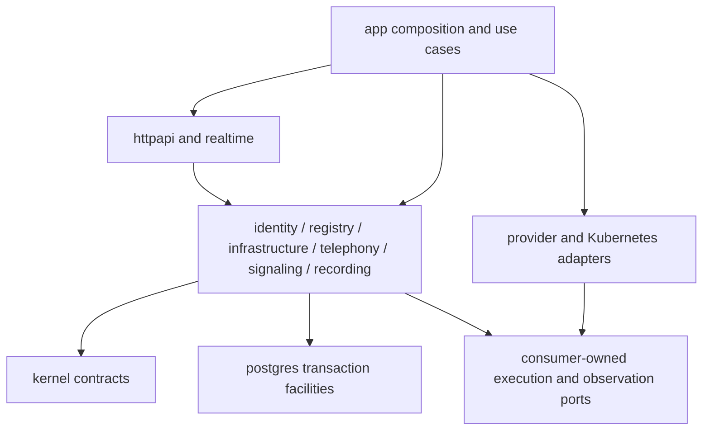

# Go-native module and process blueprint

Status: proposal, 2026-10-21; no source tree or deployment is introduced here.
Parent: [pivot report](../UTCP_GO_NATIVE_CONTROL_PLANE_ARCHITECTURE_PIVOT_AND_MIGRATION_PLAN.md).

## One application, explicit roles

Select **hybrid process topology**: one Go module and release, shared domain
packages, one `utcp` binary with explicit roles. Logical modules are not services.
Keep credential isolation where it protects authority; do not retain RPC between
ordinary domain services merely because the previous caller was PHP.

Proposed module: `github.com/grimange/unified-telephony-control-plane/apps/control-plane`.
Use Go 1.25.8 initially and existing Kubernetes libraries v0.35.3; future security
updates require the normal compatibility checks. Pin new dependency versions in
the first implementation's go.mod/go.sum; this document does not invent a tested
pgx, Goose or WebSocket version.

```text
apps/control-plane/
  go.mod, go.sum
  cmd/utcp/main.go                 explicit role selection; unknown role exits
  internal/app/                   composition, role lifecycle, cross-module use cases
  internal/postgres/              pgxpool, transaction scope, SQLSTATE classification
  internal/kernel/                operations, leases, inbox/outbox, audit, idempotency
  internal/identity/              users, tenants, memberships, capabilities, browser security
  internal/registry/              RuntimeNodes, host projections, capacity, drain/maintenance
  internal/infrastructure/        incarnations, intents, reservations, receipts, lifecycle policy
  internal/telephony/             sessions, calls/legs, conferences, bindings, domain admission
  internal/signaling/             destinations/routes/trunks, credential and projection authority
  internal/recording/             implemented capture/artifact/archive-target authority
  internal/adapters/
    kubernetes/                   existing bounded observer/effects integration
    asterisk/                     ARI, events, recording and provider translation
    freeswitch/                   ESL, event/command translation; actual supported capabilities
    simulator/                    deterministic provider oracle
    kamailio/                     signaling projections and registration observation
    rtpengine/                    existing media integration, no RTP engine replacement
  internal/httpapi/               route adapters, validation, resources, middleware
  internal/realtime/              four private-channel protocols and invalidations
  migrations/                    reviewed SQL, owned exclusively by migrate role
  tests/                         contract, PostgreSQL, process-restart and compatibility harnesses
```

These directories are created only as their first vertical slice needs them.
Do not generate empty scaffolding, generic repositories or a new application
framework. Recording and signaling are separate policy modules because their
existing authority and secret contracts merit review independently of call state.

## Dependency and transaction rules



Domain packages define narrow consumer-owned interfaces; adapter implementations
satisfy them. Kernel never imports provider clients, HTTP middleware or Kubernetes
resource types. No Kubernetes object enters tenant or telephony policy. HTTP and
broadcast payloads are projections, not canonical objects. Infrastructure consumes
registry/identity facts through application use cases; it does not query arbitrary
domain tables to invent policy.

Each module owns its SQL statements and table writes. Use explicit `pgx` queries,
not a generic CRUD ORM. `internal/postgres` owns pool/transaction mechanics only.
A module store accepts a narrow query/transaction handle. Cross-module use cases
compose participating stores in **one** transaction when the existing invariant
spans tables; never substitute multiple commits or an RPC for that atomicity.
Record dependencies and owned tables in package docs; CI import checks prohibit
reverse adapter dependencies. Review SQL write ownership and transaction tests,
not only Go's inability to import `internal` from outside the module.

## Process and credential roles

| Role | Responsibilities | Credentials and authority |
| --- | --- | --- |
| `api` | Browser/API requests, identity, canonical admission | Domain PostgreSQL role; no Kubernetes write token or provider execution secret by default |
| `command`, `reconcile`, `outbox`, `scheduler` | Existing durable operation/event work and scheduled target creation | Appropriate PostgreSQL DML; no auto-migration; database leases coordinate replicas |
| `runtime-events` | One leased provider listener per RuntimeNode/connection epoch; durable normalized inbox | Provider-specific credentials and scoped DB access; no competing PHP listener after transfer |
| `infrastructure-io` | Bounded Kubernetes effects and exact observations; no autonomous loop | Restricted Kubernetes ServiceAccount, executor mTLS identity; **no PostgreSQL/Redis credentials** |
| `observer` | Shared read-only Node/Pod collections | Read-only Kubernetes credential; no domain or write authority |
| `realtime` | Authorized subscriptions and transient invalidations | Scoped identity/revocation lookup and Redis fanout; no domain mutation |
| `migrate` | Exclusive reviewed schema changes | DDL credential absent from ordinary roles; never invoked automatically |

Roles can share a pod only if their credential boundaries remain real. Initial
production topology is separately reviewed; no Services, RBAC or routing change
is authorized by this blueprint. A single binary reduces release divergence;
separate binaries offer little present value. Credentials and role config, not
binary names, establish isolation. Do not run every role in one process.

`infrastructure-io` keeps a narrow authenticated execution boundary because
Kubernetes mutation privilege is materially different from public API privilege.
The canonical Go worker calls domain services in process, reserves a dispatch in
PostgreSQL, then sends its exact action to IO. IO consumes the reservation through
the Go kernel's private mTLS seam immediately before dispatch. This replaces the
Laravel callback; shared `Verifier` interfaces remain injectable. A future
co-location proposal needs an explicit security decision, not merely a language
change.

## Concrete implementation choices

| Concern | Selected approach | Reason and limit |
| --- | --- | --- |
| HTTP | Standard `net/http` + Go 1.22+ ServeMux patterns | Method/path routing is sufficient; preserve current middleware order and error resources, not Laravel class names |
| Database | `pgx/v5`, `pgxpool`, explicit SQL and transaction functions | Actual PostgreSQL locking and types; avoid a second ORM authority |
| Migrations | Goose v3 SQL, pgx database/sql adapter only for migrate role | Reviewable SQL history; baseline adoption needs its own schema verification |
| Workers | PostgreSQL `SKIP LOCKED`, existing attempts/leases, bounded polling; scheduler emits idempotent durable work | Preserve C0; do not replace with an independent Redis queue engine |
| Notifications | Redis transient fanout, Go Pusher protocol subset | Vue Echo compatibility, reconnect reads canonical API |
| WebSocket transport | `github.com/coder/websocket`, bounded application protocol | Library supplies framing, not Reverb/Pusher semantics |
| Logging | `log/slog` JSON, explicit safe fields | Request/operation/attempt/incarnation/correlation IDs; no raw intent, tokens or secrets |
| Metrics | Prometheus-compatible existing metric names/labels | Preserve scrape contract; no tenant/node unbounded metric labels; new counters additive |
| Errors | Internal typed codes + existing HTTP resources + infrastructure result taxonomy | Separate unauthorized, stale, unavailable, rejected and outcome-unknown; stable public messages |
| Wiring | Constructors and an application composition root | No reflection container or service locator needed |
| Runtime clients | Context-aware bounded ports per provider | No generic “execute arbitrary command” transport |

ServeMux supports method/wildcard routing in [Go's release documentation](https://go.dev/doc/go1.22).
The selected [WebSocket library](https://github.com/coder/websocket) does not
supply the [Pusher protocol](https://pusher.com/docs/channels/library_auth_reference/pusher-websockets-protocol/).

## Lifecycle, limits and proof

Startup validates role, config, keys, schema compatibility and dependency health;
readiness fails closed. Liveness does not require a healthy upstream. Use explicit
constructor dependencies, config loaded once plus validated atomic credential
rotation. SIGTERM stops admission, cancels acquisitions, bounds drain time,
persists unresolved dispatched effects, closes listeners, and releases only
claims still owned. A timeout after dispatch cannot be reported unexecuted.

Use bounded role-level and upstream concurrency, request sizes and deadlines;
propagate context and avoid automatic mutation retries. Separate worker pools
prevent a slow provider starving API requests. No unbounded background goroutine
per tenant or RuntimeNode. Shared snapshots avoid per-node cluster-wide lists.

Proof layers: pure state-machine tests; PHP/Go wire/crypto/fingerprint oracles;
real PostgreSQL transactions and process restart; existing fake/HTTP simulations;
existing real Kubernetes tests when infrastructure semantics change; browser/API
contract replay; independently reviewed deployment and natural telephony proof.
No benchmark or resource saving is asserted by this design.
