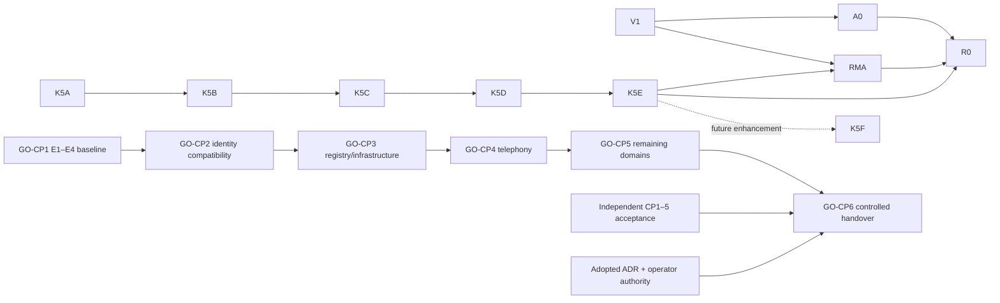

# Migration execution and recovery plan — proposal only

## Preconditions and source authority

Use existing workspace/project IDs from the read snapshot. No project creation, MCP replacement, infrastructure action, source cleanup, staging, commit or push is implied. Check automation/integration settings through operator-visible administration before K2: configured MCP cannot read these settings, and the audit forbids triggering integrations. No such trigger has been invoked. The canonical RMA-E design next action is unchanged.

K0 has produced a 151-record inventory, 499-source artifact catalog, 26 remote-unit dry-run plan, 13 suggested initial units and six historical-summary units. This is a candidate set for operator review, not approval to create all units. Source identities and proof/acceptance dimensions remain versioned.

## Bounded stages

| Stage | Work and write boundary | Exit gate |
| --- | --- | --- |
| K0 current assignment | Repository/Kaneo reads; new local audit documents only | Inventory, capabilities, key/link checks and preservation validated; limitations explicit |
| K1 mapping freeze and approval packet | Refresh both snapshots; approve minimal task subset, payload descriptions, typed relations, priorities and historical closure convention. No Kaneo writes | Reviewed payload manifest with exact hashes and IDs; zero ambiguity, duplicate keys, missing references, or unapproved acceptance; reconcile stale source status via ledger precedence |
| K2 controlled initial import | Separate explicit operator authorization for allowlisted project, exact keys and operation kinds | Single writer; snapshot refresh; create or reconcile one record; journal returned ID immediately; get_task read-after-write confirms exact fields, project, key and source hash; no unrelated automation |
| K3 concise history and dependency import | Separate approval; six aggregate summaries rather than 63 historical tasks | Source status attribution intact; no self-acceptance; create relations only after all IDs known; graph and task scope match payload |
| K4 dual-read reconciliation | Read both sources; report drift, no authority transfer | Missing=0, duplicate=0, misclassified=0, orphaned=0 for approved subset; phase/ADR/proof unchanged; any mismatch explicitly resolved by its owner |
| K5 operational authority decision | Explicit operator approval and separately reviewed governance/instruction/validator changes | Each dimension has one owner; offline CI retained; ledger role explicitly chosen; no circular sync; workers know accepted source |
| K6 ongoing worker protocol | Only approved operations, single assignment owner, evidence-first updates | Start references authorized scope; progress is factual; self-test becomes in-review; independent reviewer links decision; operator closes; cancellation/supersession has explicit reason and preserved history |

K2 and K3 may share one controlled import packet only if its exact subset and history policy are approved. K5 cannot be inferred from successful imports. Existing workstreams and production cutover remain separate from tracker migration.

## Durable identity and reconciliation algorithm

Each source record has a stable `utcp:<id>` migration key. Titles are display text. Historical source keys map many-to-one to a stable summary unit; the manifest preserves every source ID and path. For sources without canonical IDs, this audit proposes explicit keys, subject to K1 freeze. No custom field is assumed.

Use an exact task-description marker such as `UTCP-Migration-Key: utcp:go-cp2-e1`, plus project ID, source IDs, source revision and per-file SHA-256. Maintain a repository-side mapping manifest with source ID/key/path/hash, project/task IDs, intended fields, status dimensions, action, before/after payload hash, reconciliation state, run ID and returned relation IDs. Freeze an approved payload digest before K2. The preview's task IDs are null because zero matching tasks exist; never invent ticket numbers.

Before every future create: list every task page and every related page in the allowlisted project, fetch descriptions when list response defers them, inspect exact marker, then reconcile against the durable mapping. Zero matches permits approved creation; one exact match permits read/reconcile, not blind overwrite; multiple matches stop that key. Similar titles are review candidates, never identity matches. Search is corroboration only because it is bounded and has no pagination parameter. Archived/planned arrays must also be inspected; report any connector gap rather than recreate an inaccessible record.

After a successful create, persist returned ID before any next operation; read it back and verify project/key/title/status/description/priority/source hash. After a timeout, do not retry create until a full fresh marker reconciliation resolves whether it committed. If mapping persistence failed after remote success, recover by exact marker. Complete relations only after both endpoints exist; deduplicate by source, type and target, preserving returned relation ID. Parent source points to child; blocks points from prerequisite to dependent. Only typed hard gates become blocks; historical context/preferred sequencing become related or prose. Satisfied historical prerequisites need not become active blockers.

There is no exposed conditional task update or transaction API. Do not claim atomic upsert, exactly-once create or safe parallel writers. Hold a single migration writer outside Kaneo, compare fetched payload hashes against the approved baseline immediately before update, and stop on any concurrent change. This reduces the race but does not eliminate a concurrent external writer; operator must keep the approved project import window exclusive. Never use fetch/merge/full update to overwrite a reviewer or operator decision.

## Task description template

```text
UTCP-Migration-Key: <stable unit key>
Source IDs: <all mapped source records>
Workstream / type: <parent or milestone or scoped task>
Engineering objective: <source-backed outcome>
Scope / exclusions: <bounded work>
Acceptance criteria: <explicit proof and governance gates>
Dependencies: <typed prerequisites, not every historical document>
Worker / professional role: <only explicit assignment; not a fabricated assignee>
Execution / authorization: <separate values and decision link>
Implementation / evidence level: <reported developer-tested etc.>
Independent review: <unknown/pending/decision+artifact>
Operator acceptance: <unknown/decision+scope>
Production state: <not integrated, or exact authorized proof>
Source links / verification reports: <versioned repository links>
Operator decision needed: <exact unresolved decision>
Last reconciled source revision: <HEAD plus source file hashes>
```

Priority defaults to no-priority; no assignee or due date. Preserve source R0-Critical and canonical-next-action facts as text. Existing workspace Blocked, Proposed / not adopted, Roadmap planning and Historical reference labels can be reused after approval. Workstream is a description property and parent relation initially; no extra projects/labels required.

## Dependency design



RMA-C/D supply artifact/target contracts before RMA-E; RMA-F/G/H remain named parent acceptance slices until bounded tasks are designed. Do not manufacture a strict blocking chain among every RMA slice. GO-CP2 E1 has no GN-G3 prerequisite. Immutable publication and baseline checker repair gate CP3 production integration; Vue scanner classification gates CP2/CP6 security acceptance, not every isolated test. CP4 domain callbacks participate in the final CP3 authority transfer, not CP3 isolated implementation: model this as an acceptance gate, avoiding an artificial CP3↔CP4 implementation cycle. No confirmed hard-dependency cycle was found in the typed preview graph. GN-G3's extraction strategy must be reconciled with the broader CP6 cohort before live work; it is retained Git context rather than a competing active cutover task.

## Drift, outages and rollback

Through K4, discrepancies resolve using Git ledger/accepted ADR/proof ownership. Kaneo changes are proposals to reconcile, not automatic edits to Git. After K5, a Kaneo operational edit updates only the operational dimension; technical acceptance still requires Git evidence and explicit actors. Do not use timestamps to let an operational column overwrite a phase classification. Source revision/hash mismatch puts the record in needs-review and stops updates. Kaneo downtime delays operational sync; source/test/CI validation stays available offline and must never infer acceptance from stale cached tasks.

Rollback is non-destructive reconciliation. Keep Git original sources and mapping journal. On partial import, stop further writes, inventory exact committed IDs and verified payloads, resume idempotently from unknown/pending entries after read reconciliation. Reverting approved imported fields or archiving/deleting run-created tasks requires separate authorization and before/after review; current connector exposes no archive tool. Do not automatically delete tasks or comments, undo accepted operator decisions, delete evidence, reset Git, or reuse IDs. Unrelated or pre-existing tasks are outside rollback ownership. No database, runtime or infrastructure rollback is part of this migration.

## Material risk register

| Risk / grounded exposure | Consequence | Prevention | Detection | Recovery |
| --- | --- | --- | --- | --- |
| Historical loss; hundreds of evidence artifacts exist | Erased proof or context | Git retention, six concise summaries with links | Source hashes/link checks, source-ID coverage | Recover links from manifest; never delete Git history |
| Duplicate imports; create has no external-ID argument | Duplicate authority/work | Exact description marker, map, full reconciliation before create | Duplicate-key/marker count and remote ID scan | Stop key; operator approves merge/archive disposition |
| Wrong status or developer proof treated accepted; reports explicitly warn | False completion | Separate dimensions, no automatic Done | Crosswalk and role/artifact checks | Restore approved fields with preserved audit trail |
| Proposed ADR treated adopted | Unauthorized architecture | Git adoption link mandatory | Compare ADR status/source hash | Stop closure; correct projection only |
| RMA priority displaced; existing roadmap residue confirmed | Wrong program next action | Ledger RMA-E next action retained | Compare parent/objective against ledger | Correct approved task queue; ledger unchanged |
| Missing source links; many inputs untracked | Unreviewable task claims | Hash HEAD+working tree; preserve sources before permanent remote revision links | File/link and tracked/untracked checks | Use reviewed preservation assignment; never publish broken revision URLs |
| Existing or concurrent Kaneo collision; none at audit time | Duplicate or overwritten task | Re-read, allowlist, single writer | Full pages, exact keys, before/after hashes | Stop and reconcile, no blind update |
| Partial import or timeout; no remote transaction exposed | Unknown committed creates/relations | Journal every returned ID; marker reconciliation | Read-after-write, pending/unknown entries | Resume from reads; no unconditional retry/create |
| Permissions/custom-field/column/config limits | Unsupported plan or hidden automation | Confirmed existing columns and description fallback; operator automation check | Capability/permission error and explicit preflight | Reduce scope; separate admin change only if authorized |
| Secrets in copied reports | Credential disclosure | Concise allowlisted summaries, repository scanner plus review | Scan exact payloads; do not suppress known finding broadly | Stop publication; authorized incident response if actual leak, no secret reproduction |
| Drift/stale worker updates; update_task merges then full-updates | Lost reviewer/operator state | One owner per field, expected payload hash, exclusive import window | Reconcile changes and artifact revision | Stop stale writer; owner resolves conflict |
| Multiple AI workers | Conflicting task transitions | One assignment claim, implementer/reviewer roles separate | Activity + mapping ownership review | Human owner resolves; no last-writer-wins |
| Unrelated project mutations; connection sees two projects | Cross-project damage | Exact workspace/project/task allowlist | Read-back project ID on every object | Stop; separately authorized corrective review |
| Rollback removes data | Lost decisions/comments | Preserve IDs and before values; no automatic delete | Run-owned object inventory | Forward reconcile; separate archive/delete authorization |
| Kaneo availability enters CI | Offline validation becomes impossible | Keep Git validators local | CI network dependency review | Disable only approved sync process, retain last verified map |

No numeric likelihoods are inferred. Exposures are actual source/tool properties; future race/failure occurrence is not claimed.

Operator decisions before K2: exact task subset and closure policy; workflow/field authority convention; single-writer import window; automation/integration trigger safety via existing UI/admin; write permission verification inside later authorized preflight; preservation/publication of currently untracked evidence so remote links identify immutable artifacts. No operator prerequisite was needed to finish this read-only audit. There is no new host, cluster, namespace, database, external call or package requirement.
